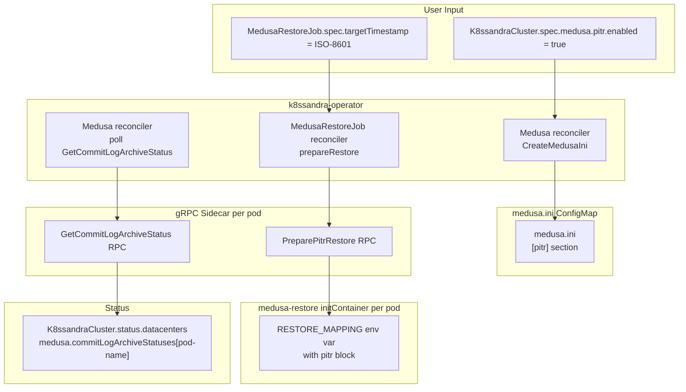
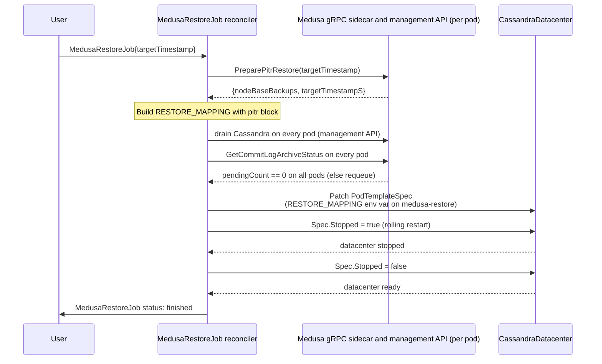

# Point-in-Time Recovery (PITR) for k8ssandra-operator

- **Author(s):** (your name)
- **Status:** Draft
- **Reviewers:**

---

## 1. Context and Scope

### Background

k8ssandra-operator manages Cassandra clusters on Kubernetes. It already orchestrates backups and restores through Medusa: the operator creates `MedusaBackupJob` and `MedusaRestoreJob` CRDs, drives the Medusa gRPC sidecar on each pod, and injects `RESTORE_MAPPING` into the `medusa-restore` initContainer as an env var.

Medusa is gaining PITR support — continuous archiving of Cassandra commitlog segments and a `PreparePitrRestore` RPC that resolves per-node base backups for a given target timestamp. The full Medusa contract is described in [`cassandra-medusa/docs/superpowers/specs/pitr-design-doc.md`](../../cassandra-medusa/docs/superpowers/specs/pitr-design-doc.md).

The operator's role is narrowly defined:

1. Let the user **enable PITR** by setting it in the Medusa config (which the operator renders into `medusa.ini` via a ConfigMap).
2. Let the user **execute a PITR restore** by specifying a `targetTimestamp` on `MedusaRestoreJob` instead of a backup name.
3. **Expose archiving health** — relay `GetCommitLogArchiveStatus` into a readable status field so the user can see what is happening without talking to gRPC directly.

The operator is already widely deployed. Every change must be additive and optional. Users who do not opt in must see zero behaviour change.

### Problem Statement

Today, `MedusaRestoreJob` requires a `spec.backup` name. There is no way to say "restore to 14:23:05 on Tuesday." Enabling archiving requires hand-editing the ConfigMap that Medusa reads. There is no status surface for commitlog archiving health.

### Why Now

Medusa's gRPC server now exposes `GetCommitLogArchiveStatus` and `PreparePitrRestore`. The operator can wire those two RPCs into the existing reconcile pattern with minimal new surface area.

### Scope

**In scope:**
- A new optional `pitr` field on `MedusaClusterTemplate` that maps to the `[pitr]` section in `medusa.ini`.
- A new optional `targetTimestamp` field on `MedusaRestoreJobSpec`. Setting it triggers the PITR restore path.
- In `RestoreJobController`, calling `PreparePitrRestore` instead of `GetHostMap` when `targetTimestamp` is set. PITR is always in-place, so no host map is built.
- A drain gate in `RestoreJobController`: before the datacenter is stopped for a PITR restore, every Cassandra node is drained and every commitlog spool is uploaded (§4.7, "Drain gate").
- Extending `MedusaRestoreMapping` (the `RESTORE_MAPPING` JSON structure) with a `pitr` block so Medusa's initContainer can resolve per-node base backups and download commitlog segments.
- A `MedusaStatus` struct added to `K8ssandraStatus` (the per-DC status bucket in `K8ssandraCluster.status.datacenters[name]`), holding a `map[podName]CommitLogArchiveStatus` populated by polling `GetCommitLogArchiveStatus` on every pod.
- Regenerating Go gRPC stubs from the updated `medusa.proto`.
- Unit and integration tests covering the new paths, with zero regressions on existing paths.

**Out of scope:**
- Cross-DC PITR restore. The restore orchestration is strictly cluster-local; a `MedusaRestoreJob` always targets a single `CassandraDatacenter`.
- Managing `commitlog_archiving.properties` directly — Medusa's initContainer owns that file.
- Starting or stopping Cassandra — cass-operator handles that.
- New CLI commands or new CRDs — all changes extend existing objects.
- Timeline floor across repeated PITR restores. A later PITR of the same DC can replay commitlogs from the discarded timeline. This is handled in a separate, parallel effort, not in this doc. The drain gate (§4.7) keeps the old spool from reaching the bucket after the restore. It does not replace the timeline floor.

---

## 2. Goals and Non-Goals

### Goals

- **G1:** Users enable PITR by setting one field (`spec.medusa.pitr.enabled: true`) on an existing CRD. No new CRD, no new controller, no new sidecar.
- **G2:** `pitr.enabled: false` (the default) produces zero behaviour change — existing backup, restore, and purge flows are untouched.
- **G3:** A PITR restore is driven through the same `MedusaRestoreJob` object and the same rolling-restart machinery that backup restores use today.
- **G4:** The operator never needs direct knowledge of commitlog internals. All PITR-specific logic runs inside Medusa; the operator only passes a timestamp and routes the result.
- **G5:** Operators can observe archiving health from Kubernetes (`kubectl get k8ssandracluster`) without gRPC access.

### Non-Goals

- **NG1:** Providing a use-case path for recovering individual tables or keyspaces — PITR targets the full cluster state at a point in time.
- **NG2:** Recovering to a timestamp that falls before any available base backup — the operator surfaces a clear error; it does not synthesise missing data.
- **NG3:** UI or CLI tooling beyond the CRD surface; all interaction is through Kubernetes objects.

### Success Criteria

| # | Criterion | How verified |
|---|---|---|
| SC1 | `pitr.enabled: true` in `K8ssandraCluster` causes the operator to emit a `[pitr]` section in `medusa.ini`; `pitr.enabled: false` (or absent) produces no `[pitr]` section | Unit test on `CreateMedusaIni` |
| SC2 | A `MedusaRestoreJob` with `targetTimestamp` set calls `PreparePitrRestore`, sets the `pitr` block in `RESTORE_MAPPING`, and completes the rolling restart | Integration test |
| SC3 | A `MedusaRestoreJob` with both `backup` and `targetTimestamp` set is rejected by the webhook | Webhook unit test |
| SC4 | A `MedusaRestoreJob` without `targetTimestamp` follows the existing code path with no behaviour change | Existing test suite; zero new failures |
| SC5 | `GetCommitLogArchiveStatus` is called for every pod; each result is reflected at `K8ssandraCluster.status.datacenters[dc-name].medusa.commitLogArchiveStatuses[pod-name]` | Unit test with mock gRPC client returning distinct responses per pod |

---

## 3. Overview (Executive Summary)

The feature has three parts:

1. **Config surface (`pitr` field on `MedusaClusterTemplate`):** A new optional `Pitr *PitrConfig` field. When set and `Enabled: true`, `CreateMedusaIni` renders a `[pitr]` section in the `medusa.ini` ConfigMap. The section is opaque to the k8ssandra-operator; it passes through whatever Medusa expects, defaulting to Medusa's own defaults when fields are absent. When `Pitr` is nil or `Enabled` is false (the default), no `[pitr]` section is emitted.

2. **PITR restore path (`targetTimestamp` on `MedusaRestoreJobSpec`):** When `targetTimestamp` is set, the restore reconciler executes fail-fast validation before touching the cluster:
   - First, it verifies that PITR is enabled (`spec.medusa.pitr.enabled: true`) on the datacenter. If PITR is disabled, the restore job fails immediately without requeue.
   - Second, in `prepareRestore`, it calls `PreparePitrRestore(targetTimestamp)` on a live Medusa gRPC sidecar. Medusa queries object storage and validates base backup eligibility for every node in the cluster topology (`snapshot_time <= target_timestamp`).
   - If any node in the cluster lacks an eligible base backup, Medusa returns `FAILED` immediately. The operator marks `MedusaRestoreJob` failed with a terminal error and stops reconciliation. No pods are stopped, no data is modified, and no StatefulSets are patched.
   - Only on success does the reconciler assemble `RESTORE_MAPPING` with the `pitr` block (`target_timestamp_s` and `node_backups`) and mark the restore prepared.
   - Then the reconciler runs the drain gate. It drains Cassandra on every pod, so no new commitlog segments are written. It waits until every Medusa archiver has uploaded its whole spool. A node does not go down before its commitlogs are in the bucket.
   - Only then does the reconciler stop the datacenter and proceed with rolling restart. Inside each initContainer: `restore.py` downloads per-node base SSTables; `pitr_restore.py` queries object storage for commitlog segments archived since the base backup, stages them locally, and configures `commitlog_archiving.properties` for Cassandra replay up to the target timestamp.

3. **Archiving status surface:** A new `Medusa *MedusaStatus` field on `K8ssandraStatus` (`.status.datacenters[name]`), carrying a `map[string]CommitLogArchiveStatus` keyed by pod name and a `lastStatusPoll` timestamp. Polling runs during Medusa reconciliation when `pitr.enabled = true`, throttled to once per `archiveIntervalSeconds` (default: 60s). If the interval has not elapsed since `lastStatusPoll`, gRPC polling is skipped. When polling runs, if a pod fails, the reconciler logs a warning and records the failure directly in that pod's entry (`Running: false`, `Status: FAILED`, `LastError: <error-message>`). Stale success data is not retained. Polling errors do not block backup, restore, or purge operations.

The design is purely additive. Existing backup, restore, and purge flows are unchanged when `targetTimestamp` is absent and `pitr.enabled` is false. Commitlog purge is handled entirely inside Medusa's own `purge_commitlogs` function, invoked during the existing `medusa purge` command — no operator changes are required for purge.

---

## 4. Proposed Architecture & Detailed Design

### 4.1 System Architecture



**Restore sequence with `targetTimestamp`:**



### 4.2 Complete File Map

| File | Change | Responsibility |
|---|---|---|
| [`apis/medusa/v1alpha1/medusa_types.go`](../../apis/medusa/v1alpha1/medusa_types.go) | Modify | Add `Pitr *PitrConfig` to `MedusaClusterTemplate`; add `PitrConfig` struct |
| [`apis/medusa/v1alpha1/medusarestorejob_types.go`](../../apis/medusa/v1alpha1/medusarestorejob_types.go) | Modify | Add `TargetTimestamp string` to `MedusaRestoreJobSpec`; make `Backup` optional; add `PitrBlock` to `MedusaRestoreMapping`; add `DatacenterDrained` to `MedusaRestoreJobStatus` |
| [`apis/medusa/v1alpha1/zz_generated.deepcopy.go`](../../apis/medusa/v1alpha1/zz_generated.deepcopy.go) | Re-generate | Deep copy for `PitrConfig` and `PitrRestoreBlock` |
| [`apis/k8ssandra/v1alpha1/k8ssandracluster_types.go`](../../apis/k8ssandra/v1alpha1/k8ssandracluster_types.go) | Modify | Add `Medusa *MedusaStatus` to `K8ssandraStatus`; add `MedusaStatus` and `CommitLogArchiveStatus` structs |
| [`apis/k8ssandra/v1alpha1/zz_generated.deepcopy.go`](../../apis/k8ssandra/v1alpha1/zz_generated.deepcopy.go) | Re-generate | Deep copy for `MedusaStatus` and `CommitLogArchiveStatus` |
| [`pkg/medusa/reconcile.go`](../../pkg/medusa/reconcile.go) | Modify | Extend `CreateMedusaIni` to render `[pitr]` section when `pitr.enabled = true` |
| [`pkg/cassandra/management.go`](../../pkg/cassandra/management.go) | Modify | Add `DrainNode` to `ManagementApiFacade` (wraps `CallDrainEndpoint`); re-generate `pkg/mocks/ManagementApiFacade.go` |
| [`pkg/medusa/grpc.go`](../../pkg/medusa/grpc.go) | Modify | Add `GetCommitLogArchiveStatus` and `PreparePitrRestore` to `Client` interface and `defaultClient` |
| [`pkg/medusa/medusa.proto`](../../pkg/medusa/medusa.proto) | Modify | Add `GetCommitLogArchiveStatus` and `PreparePitrRestore` RPCs and message types (additive only) |
| [`pkg/medusa/medusa.pb.go`](../../pkg/medusa/medusa.pb.go) | Re-generate | Protobuf generated code |
| [`pkg/medusa/medusa_grpc.pb.go`](../../pkg/medusa/medusa_grpc.pb.go) | Re-generate | gRPC generated code |
| [`controllers/medusa/medusarestorejob_controller.go`](../../controllers/medusa/medusarestorejob_controller.go) | Modify | Add PITR branch in `prepareRestore`; extend `podTemplateSpecUpdateComplete` and `updateMedusaRestoreInitContainer`; add `validateTargetTimestamp`; add `drainGate` before `stopDatacenterRestoreJob` |
| [`controllers/medusa/medusarestorejob_controller_test.go`](../../controllers/medusa/medusarestorejob_controller_test.go) | Modify | Add PITR restore test cases |
| `apis/medusa/v1alpha1/medusarestorejob_webhook.go` | New | Validating webhook: exactly one of `backup` / `targetTimestamp`; `targetTimestamp` parses. No MedusaRestoreJob webhook exists today |
| `apis/medusa/v1alpha1/medusarestorejob_webhook_test.go` | New | Webhook unit tests (SC3) |
| [`main.go`](../../main.go) | Modify | Register the MedusaRestoreJob webhook, next to `SetupMedusaBackupScheduleWebhookWithManager`; pass `ManagementApi` to `MedusaRestoreJobReconciler` |
| `config/webhook/manifests.yaml` | Re-generate | `make manifests` picks up the new `+kubebuilder:webhook` marker |

### 4.3 API Changes

#### 4.3.1 `PitrConfig` on `MedusaClusterTemplate`

A new optional struct mirroring Medusa's `[pitr]` section:

```go
// PitrConfig configures Medusa's PITR commitlog archiving.
// Rendered as a [pitr] section in medusa.ini when Enabled is true.
type PitrConfig struct {
    // Enabled turns on continuous commitlog archiving.
    // Defaults to false.
    // +kubebuilder:default=false
    Enabled bool `json:"enabled"`

    // ArchiveIntervalSeconds is how often the commitlog spool is drained to object storage.
    // Defaults to Medusa's built-in default (60s) when absent.
    // +optional
    ArchiveIntervalSeconds *int `json:"archiveIntervalSeconds,omitempty"`

    // SpoolDir is the local directory where Cassandra hardlinks finalized commitlog segments.
    // Must be on the same filesystem as the Cassandra commitlog directory.
    // Defaults to Medusa's buil-in default /var/lib/cassandra/commitlog_spool_dir when absent.
    // +optional
    SpoolDir string `json:"spoolDir,omitempty"`
}
```

Added to `MedusaClusterTemplate`:

```go
// Pitr configures Point-in-Time Recovery commitlog archiving.
// Leave nil or set Enabled=false (the default) for no behaviour change.
// +optional
Pitr *PitrConfig `json:"pitr,omitempty"`
```

#### 4.3.2 `targetTimestamp` on `MedusaRestoreJobSpec`

```go
type MedusaRestoreJobSpec struct {
    // The name of the MedusaBackup to restore.
    // Mutually exclusive with TargetTimestamp. One of the two must be set.
    // +optional
    Backup string `json:"backup,omitempty"`

    // Name of the Cassandra datacenter to perform the restore on.
    CassandraDatacenter string `json:"cassandraDatacenter"`

    // TargetTimestamp is the point in time to restore to. Accepts ISO-8601 (UTC)
    // or a Unix epoch float string. Mutually exclusive with Backup.
    // Requires pitr.enabled=true on the K8ssandraCluster.
    // +optional
    TargetTimestamp string `json:"targetTimestamp,omitempty"`
}
```

**Validation rule** (webhook): exactly one of `backup` and `targetTimestamp` must be non-empty. If both or neither are set, the webhook rejects the object.

#### 4.3.3 `PitrRestoreBlock` in `MedusaRestoreMapping`

The existing `MedusaRestoreMapping` struct gains an optional `Pitr` field:

```go
type MedusaRestoreMapping struct {
    // Whether the restore is in-place or not
    // +optional
    InPlace *bool `json:"in_place"`

    // Mapping between source and target nodes for a restore
    HostMap map[string]MappingSource `json:"host_map,omitempty"`

    // Pitr contains PITR-specific restore parameters.
    // Present only for PITR restores; absent for backup restores.
    // +optional
    Pitr *PitrRestoreBlock `json:"pitr,omitempty"`
}

// PitrRestoreBlock is the pitr sub-object inside RESTORE_MAPPING.
// It is read by Medusa's pitr_restore.py to determine which commitlog segments
// to download and what timestamp to replay to.
type PitrRestoreBlock struct {
    // TargetTimestampS is the Unix epoch float timestamp to restore to.
    TargetTimestampS float64 `json:"target_timestamp_s"`

    // NodeBackups maps each node FQDN to the base backup name selected by PreparePitrRestore.
    NodeBackups map[string]string `json:"node_backups"`
}
```

For a PITR restore, the operator sets `in_place` to `true`. Each pod finds its own base backup in `pitr.node_backups`.

When `json.Marshal` is called on `MedusaRestoreMapping`, the resulting JSON matches the format that Medusa's `pitr_restore.py` reads.

For a two-node cluster, the full `RESTORE_MAPPING` env var set on every pod's initContainer looks like this (from the Medusa spec, §4.7):

```json
{
  "in_place": true,
  "host_map": {
    "node1.fqdn": {"source": ["node1.fqdn"], "seed": false},
    "node2.fqdn": {"source": ["node2.fqdn"], "seed": false},
    "node3.fqdn": {"source": ["node3.fqdn"], "seed": false}
  },
  "pitr": {
    "target_timestamp_s": 1721000000.0,
    "node_backups": {
      "node1.fqdn": "backup-20240715-node1",
      "node2.fqdn": "backup-20240715-node2",
      "node3.fqdn": "backup-20240715-node3"
    }
  }
}
```

The same JSON is set identically on every pod. Each pod's `pitr_restore.py` reads its own `fqdn` and looks up `pitr.node_backups[fqdn]` to find its assigned base backup. The `host_map` is present because `in_place` is `true` and every node maps to itself; Medusa reads it only when `in_place` is `false`, but the operator includes it for consistency with the existing mapping structure.

### 4.4 `medusa.proto` Changes

Two new RPCs are added to the `Medusa` service (additive — no existing RPCs or field numbers changed):

```protobuf
rpc GetCommitLogArchiveStatus(GetCommitLogArchiveStatusRequest)
    returns (GetCommitLogArchiveStatusResponse);

rpc PreparePitrRestore(PreparePitrRestoreRequest)
    returns (PreparePitrRestoreResponse);

message GetCommitLogArchiveStatusRequest {}

message GetCommitLogArchiveStatusResponse {
  bool       running         = 1;
  int64      lastUploadTime  = 2;
  int32      pendingCount    = 3;
  int32      intervalSeconds = 4;
  StatusType status          = 5;
  string     lastError       = 6;
}

message PreparePitrRestoreRequest {
  string targetTimestamp = 1;
}

message PreparePitrRestoreResponse {
  StatusType          status          = 1;
  map<string, string> nodeBaseBackups = 2;
  double              targetTimestampS = 3;
}
```

After editing `medusa.proto`, regenerate with:

```bash
protoc --go_out=. --go-grpc_out=. pkg/medusa/medusa.proto
```

### 4.5 `Client` Interface Extension

[`pkg/medusa/grpc.go`](../../pkg/medusa/grpc.go) — add two methods to `Client`:

```go
type Client interface {
    Close() error
    CreateBackup(ctx context.Context, name string, backupType string) (*BackupResponse, error)
    GetBackups(ctx context.Context) ([]*BackupSummary, error)
    PurgeBackups(ctx context.Context) (*PurgeBackupsResponse, error)
    PrepareRestore(ctx context.Context, datacenter, backupName, restoreKey string) (*PrepareRestoreResponse, error)
    BackupStatus(ctx context.Context, backupName string) (*BackupStatusResponse, error)

    // New: PITR
    GetCommitLogArchiveStatus(ctx context.Context) (*GetCommitLogArchiveStatusResponse, error)
    PreparePitrRestore(ctx context.Context, targetTimestamp string) (*PreparePitrRestoreResponse, error)
}
```

Implementations on `defaultClient` are single-line wrappers, identical in style to the existing methods.

### 4.6 `CreateMedusaIni` Extension

[`pkg/medusa/reconcile.go`](../../pkg/medusa/reconcile.go) — extend the Go template to emit the `[pitr]` block when `spec.medusa.pitr.enabled = true`:

```go
    {{- if and .Spec.Medusa.Pitr .Spec.Medusa.Pitr.Enabled }}

    [pitr]
    enabled = true
    {{- if .Spec.Medusa.Pitr.ArchiveIntervalSeconds }}
    commitlog_archive_interval_seconds = {{ deref .Spec.Medusa.Pitr.ArchiveIntervalSeconds }}
    {{- end }}
    {{- if .Spec.Medusa.Pitr.SpoolDir }}
    commitlog_spool_dir = {{ .Spec.Medusa.Pitr.SpoolDir }}
    {{- end }}
    {{- end }}
```

When `Pitr` is nil or `Enabled` is false, no `[pitr]` section is emitted; Medusa defaults to `pitr.enabled = false`.

### 4.7 Restore Reconciler — PITR Branch & Fail-Fast Strategy

[`controllers/medusa/medusarestorejob_controller.go`](../../controllers/medusa/medusarestorejob_controller.go) — The PITR restore path must fail as early as possible. If PITR is disabled or if any node lacks an eligible base backup, the restore cannot execute. The reconciler aborts before draining or stopping Cassandra, and before patching pod specs.

#### 1. Pre-flight validation & request construction

1. **`NewMedusaRestoreRequest`**:
   - For backup restore (`spec.backup != ""`), it fetches the `MedusaBackup` CR.
   - For PITR restore (`spec.targetTimestamp != ""`), `spec.backup` is empty. `NewMedusaRestoreRequest` skips the `MedusaBackup` CR fetch and leaves `req.MedusaBackup` nil.
   - `req.MedusaBackup` is used in exactly three places today. Each one must branch on `spec.targetTimestamp`:

     | Site | Backup restore | PITR restore |
     |---|---|---|
     | `Reconcile`, `validateBackupForRestore(request.MedusaBackup, cassdc)` (line 114) | unchanged | skipped; run step 3 (PITR enablement) instead |
     | `podTemplateSpecUpdateComplete`, `req.MedusaBackup.Name` (line 257) | unchanged | check `RESTORE_MAPPING` instead (see below) |
     | `updateMedusaRestoreInitContainer`, `setBackupNameInRestoreContainer(req.MedusaBackup.Name, ...)` (line 375) | unchanged | skipped (see below) |

2. **`validateRestoreSpec`**:
   - Rejects specs where both `backup` and `targetTimestamp` are set, or where neither is set.
   - Validates that `targetTimestamp` parses as ISO-8601 UTC or Unix epoch float string.

3. **Verify cluster PITR enablement**:
   - Checks the target datacenter's Medusa configuration (`spec.medusa.pitr.enabled`).
   - If PITR is disabled (`pitr.enabled != true`), the operator marks the job failed immediately:
     ```go
     request.RestoreJob.Status.FinishTime = metav1.Now()
     request.RestoreJob.Status.Message = fmt.Sprintf("PITR is disabled on CassandraDatacenter %s; restore cannot proceed", cassdc.Name)
     ```
     The reconciler returns `ctrl.Result{}, nil` (terminal error, no requeue). No restore action is executed.

#### 2. `prepareRestore` — Fail-Fast Base Backup Verification

`prepareRestore` executes before `request.RestoreJob.Status.RestorePrepared` is set to `true`, and before `request.Datacenter.Spec.Stopped` is set to `true`.

```go
func (r *MedusaRestoreJobReconciler) prepareRestore(
    ctx context.Context, request *medusa.RestoreRequest, logger logr.Logger,
) (*medusav1alpha1.MedusaRestoreMapping, error) {

    pods, err := medusa.GetCassandraDatacenterPods(ctx, request.Datacenter, r, request.Log)
    if err != nil {
        return nil, err
    }

    for _, pod := range pods {
        client, err := newClient(ctx, r.Client, request.Datacenter, ptr.To(pod), r.ClientFactory)
        if err != nil {
            logger.Error(err, "Failed to create Medusa client", "Pod", pod.Name)
            continue
        }

        if request.RestoreJob.Spec.TargetTimestamp != "" {
            // PITR path: verifies base backup eligibility across all nodes via Medusa
            return r.preparePitrRestore(ctx, request, client, logger)
        }

        // Existing backup path
        hostMap, err := medusa.GetHostMap(request.Datacenter, *request.RestoreJob, client, ctx)
        if err != nil {
            return nil, err
        }
        mapping, err := hostMap.ToMedusaRestoreMapping()
        if err != nil {
            return nil, err
        }
        return &mapping, nil
    }

    return nil, fmt.Errorf("no reachable Medusa sidecar found")
}
```

#### 3. `preparePitrRestore` — Contract with Medusa

**What Medusa does:**
- Medusa receives `PreparePitrRestore(targetTimestamp)`.
- It iterates across all nodes in the cluster topology and queries object storage for base backups.
- For each node FQDN, it evaluates `select_node_base_snapshot(storage, fqdn, target_timestamp_s)`:
  - Finds the latest backup with `snapshot_time <= target_timestamp_s`.
  - If **any** node lacks an eligible backup before `targetTimestamp`, Medusa returns `StatusType_FAILED` with an error indicating which node is missing an eligible backup.
- Medusa performs this check entirely in memory and against storage metadata. It does not stop Cassandra, modify data, or wipe directories.

**What the operator does:**
- If Medusa returns `StatusType_FAILED` or a non-recoverable error:
  - The reconciler sets `request.RestoreJob.Status.FinishTime = metav1.Now()`.
  - The reconciler sets `request.RestoreJob.Status.Message = fmt.Sprintf("PreparePitrRestore failed: %s", errMessage)`.
  - The reconciler updates status and returns `ctrl.Result{}, nil` (terminal failure, no requeue).
  - `RestorePrepared` remains `false`. The datacenter is never stopped, pod templates are untouched, and no restore mapping is written.
- If Medusa returns `StatusType_SUCCESS`:
  - The operator builds `MedusaRestoreMapping` with the returned `resp.NodeBaseBackups` and `resp.TargetTimestampS`.
  - Sets `RestorePrepared = true`.
  - Only then proceeds to stop the datacenter and initiate the rolling restore.

```go
func (r *MedusaRestoreJobReconciler) preparePitrRestore(
    ctx context.Context,
    request *medusa.RestoreRequest,
    client medusa.Client,
    logger logr.Logger,
) (*medusav1alpha1.MedusaRestoreMapping, error) {

    resp, err := client.PreparePitrRestore(ctx, request.RestoreJob.Spec.TargetTimestamp)
    if err != nil {
        return nil, fmt.Errorf("PreparePitrRestore gRPC call failed: %w", err)
    }
    if resp.Status == medusa.StatusType_FAILED {
        return nil, fmt.Errorf("no eligible base backup for at least one node before timestamp %s", request.RestoreJob.Spec.TargetTimestamp)
    }

    // Every pod of the target DC must have a base backup. Fail now, before the DC is stopped.
    if missing := medusa.PodsMissingFromNodeBackups(request.Datacenter, resp.NodeBaseBackups); len(missing) > 0 {
        return nil, fmt.Errorf("PreparePitrRestore returned no base backup for pods %v", missing)
    }

    // PITR is always in-place: no host map. Each pod reads its own entry in pitr.node_backups.
    return &medusav1alpha1.MedusaRestoreMapping{
        InPlace: ptr.To(true),
        Pitr: &medusav1alpha1.PitrRestoreBlock{
            TargetTimestampS: resp.TargetTimestampS,
            NodeBackups:      resp.NodeBaseBackups,
        },
    }, nil
}
```

> **Note on the host map during PITR:** PITR does not call `GetHostMap`. A host map translates source nodes to target nodes. PITR restores each node from its own backups (same topology, no translation). Medusa reads `host_map` only when `in_place` is `false`. The keys of `pitr.node_backups` are pod names. Each pod looks up its own name in that map.
>
> **Pod name check:** `PodsMissingFromNodeBackups` (new, in `pkg/medusa/hostmap.go`) takes the pod names from `getTargetRackFQDNs(dc)` and returns those that are not keys of `nodeBaseBackups`. If the list is not empty, the restore fails before the DC is stopped. Extra keys are ignored: the backup can hold nodes of other DCs, and the operator cannot tell them apart from extra nodes of this DC. A DC that is now smaller than at backup time is not detected.

#### 4. Drain gate — no node stops before its commitlogs are uploaded

**Why:** Each pod holds sealed commitlog segments in its spool. They are not in the bucket yet. Medusa's in-place restore cleans the commitlog directory, but not the spool. If the DC stops with a full spool, the archiver uploads those segments after the restore. They belong to the discarded timeline. A node that is still running also keeps writing new segments. So the gate does two things in order: stop new commitlogs, then upload the old ones.

**Where:** In `Reconcile`, after `RestorePrepared` is `true` and before `stopDatacenterRestoreJob`. Only for PITR restores (`spec.targetTimestamp != ""`). Backup restores skip the gate.

**Steps:**

1. **Drain Cassandra on every pod.** The reconciler calls the management API drain endpoint on each pod (`httphelper.NodeMgmtClient.CallDrainEndpoint`). A drained node flushes its memtables and accepts no more writes. It writes no new commitlog segments. The Cassandra process and the Medusa sidecar stay up, so the archiver keeps running. Drain is idempotent. When all pods are drained, the reconciler sets `Status.DatacenterDrained = metav1.Now()`. This field marks that step 1 is done and starts the wait in step 2.
2. **Wait for the spool to be empty on every pod.** The reconciler calls `GetCommitLogArchiveStatus` on every pod. A pod passes when `running == true`, `pendingCount == 0`, and `lastError == ""`. After drain, no new segment can arrive, so `pendingCount == 0` stays true.
3. **Stop the datacenter** (`stopDatacenterRestoreJob`) only when all pods pass.

**Not ready yet:** If any pod does not pass, the reconciler writes the pod names and reasons to `Status.Message` and requeues after `DefaultDelay`. The datacenter is not stopped. The archiver uploads on its own interval, so a wait of up to `archiveIntervalSeconds` is normal.

**Timeout:** If the wait exceeds 5 × `archiveIntervalSeconds` since `Status.DatacenterDrained`, the job fails. The reconciler sets `Status.FinishTime` and `Status.Message` with the failing pods. No requeue. The datacenter is not stopped and no restore data is touched. The nodes stay drained, because drain cannot be undone without a restart. The user must restart the pods, fix the archiver, and create a new `MedusaRestoreJob`. This is the same terminal-failure style as `PreparePitrRestore` failing.

**Contract with Medusa:** After drain, `pendingCount` must include the last commitlog segment that Cassandra closes during drain. If Medusa reports `0` while that segment is not yet in the spool, the gate passes too early. The integration test (§6.5 step 6) checks for this.

**Code changes:**
- `ManagementApiFacade` in [`pkg/cassandra/management.go`](../../pkg/cassandra/management.go) gains `DrainNode(pod *corev1.Pod) error`. It wraps `CallDrainEndpoint`. The mock is re-generated.
- `MedusaRestoreJobReconciler` gains a `ManagementApi cassandra.ManagementApiFactory` field, wired in [`main.go`](../../main.go) like the existing reconcilers.
- `MedusaRestoreJobStatus` gains `DatacenterDrained metav1.Time` (`json:"datacenterDrained,omitempty"`), next to `DatacenterStopped`.
- A new `drainGate(ctx, request)` function in the restore controller returns `(passed bool, err error)`. `Reconcile` calls it for PITR restores, inside the `DatacenterStopped.IsZero()` block, before `stopDatacenterRestoreJob`. If it returns `false`, `Reconcile` applies updates and requeues.

#### `podTemplateSpecUpdateComplete` for PITR

The existing check verifies that `BACKUP_NAME` and `RESTORE_KEY` env vars have propagated to StatefulSets. For PITR, `BACKUP_NAME` is not set (it is absent from the spec). The check becomes:

```go
for _, statefulset := range statefulsetList.Items {
    container := getRestoreInitContainerFromStatefulSet(&statefulset)
    if container == nil {
        return false, nil
    }

    if request.RestoreJob.Spec.TargetTimestamp != "" {
        // PITR restore: check RESTORE_MAPPING contains the pitr block instead of BACKUP_NAME
        if !utils.ContainerHasEnvVarSet(container, restoreMappingEnvVar) {
            return false, nil
        }
    } else {
        if !utils.ContainerHasEnvVar(container, backupNameEnvVar, req.MedusaBackup.Name) {
            return false, nil
        }
    }

    if !utils.ContainerHasEnvVar(container, restoreKeyEnvVar, req.RestoreJob.Status.RestoreKey) {
        return false, nil
    }
}
```

#### `updateMedusaRestoreInitContainer` for PITR

When `targetTimestamp` is set:
- Skip `setBackupNameInRestoreContainer` (no single backup name; `pitr_restore.py` reads from the `pitr` block).
- `setRestoreMappingInRestoreContainer` is called as today — with the mapping that now includes the `pitr` block.
- `setRestoreKeyInRestoreContainer` is called as today.

The `RESTORE_MAPPING` env var is set identically on every pod's initContainer (the existing `setRestoreMappingInRestoreContainer` function already marshals the full mapping struct — no change needed there, only the struct now carries the `pitr` field).

**Contract with the Medusa entrypoint:** For PITR, the operator does not set `BACKUP_NAME`. `PreparePitrRestore` returns one base backup per pod. The operator passes the full map to every pod in `pitr.node_backups`. Each pod looks up its own entry by `POD_NAME`. The Medusa restore entrypoint must therefore run the SSTable restore step when `RESTORE_KEY` is set and `RESTORE_MAPPING` contains a `pitr` block, even if `BACKUP_NAME` is empty. If the entrypoint gates only on `BACKUP_NAME`, the SSTable step is skipped and commitlogs replay onto unrestored data.

### 4.8 Archiving Health Status

`GetCommitLogArchiveStatus` is a per-pod RPC — one Medusa gRPC sidecar runs per Cassandra pod, and each node archives independently with its own spool directory, upload lag, and error state. The operator polls every pod and surfaces the results as a map keyed by pod name, giving operators immediate visibility into which node is failing without gRPC access.

**Type definitions:**

```go
// CommitLogArchiveStatus mirrors a single GetCommitLogArchiveStatusResponse from Medusa.
// One entry per pod, keyed by pod name.
type CommitLogArchiveStatus struct {
    // Running is true while the CommitLogArchiver background thread is alive.
    Running bool `json:"running"`

    // LastUploadTime is the Unix epoch time of the most recent successful upload. 0 if never uploaded.
    LastUploadTime int64 `json:"lastUploadTime,omitempty"`

    // PendingCount is the number of commitlog segments in the spool not yet uploaded.
    PendingCount int32 `json:"pendingCount,omitempty"`

    // IntervalSeconds is the configured drain interval.
    IntervalSeconds int32 `json:"intervalSeconds,omitempty"`

    // Status is IN_PROGRESS (archiver running) or FAILED (archiver stopped unexpectedly, or operator poll failed).
    Status string `json:"status,omitempty"`

    // LastError is non-empty when the sidecar reports an error or when the operator fails to poll the pod.
    LastError string `json:"lastError,omitempty"`
}

// MedusaStatus holds PITR-related status for one datacenter.
type MedusaStatus struct {
    // LastStatusPoll is the timestamp when the operator last polled the Medusa sidecars for archiving status.
    // +optional
    LastStatusPoll *metav1.Time `json:"lastStatusPoll,omitempty"`

    // CommitLogArchiveStatuses maps pod name to that pod's archiver status.
    // Populated when pitr.enabled = true; absent otherwise.
    // +optional
    CommitLogArchiveStatuses map[string]CommitLogArchiveStatus `json:"commitLogArchiveStatuses,omitempty"`
}
```

Added to `K8ssandraStatus`:

```go
// Medusa holds PITR archiving health for this datacenter.
// +optional
Medusa *MedusaStatus `json:"medusa,omitempty"`
```

**Where to store it:** `K8ssandraCluster.status.datacenters[dc-name].medusa.commitLogArchiveStatuses[pod-name]`. Add `Medusa *MedusaStatus` to `K8ssandraStatus` in [`apis/k8ssandra/v1alpha1/k8ssandracluster_types.go`](../../apis/k8ssandra/v1alpha1/k8ssandracluster_types.go). This follows the same pattern as the existing `Cassandra`, `Stargate`, and `Reaper` fields on that struct.

**When to poll:** Inside the existing Medusa reconcile loop, when `pitr.enabled = true`:
1. **Interval:** The polling interval is `spec.medusa.pitr.archiveIntervalSeconds` (default 60s). The operator does not poll faster than Medusa uploads. There is no separate knob.
2. **Throttling:** Compare `now` with `status.datacenters[dc-name].medusa.lastStatusPoll`. If `now - lastStatusPoll < interval`, skip gRPC calls to avoid network overhead during frequent reconciliations.
3. **Execution:** When the interval has elapsed (or `lastStatusPoll` is nil):
   - Set `lastStatusPoll = metav1.Now()`.
   - Iterate every pod returned by `GetCassandraDatacenterPods` and call `GetCommitLogArchiveStatus`.
   - **On success:** Write the response fields into `commitLogArchiveStatuses[pod.Name]`.
   - **On poll failure:** Log a warning and overwrite `commitLogArchiveStatuses[pod.Name]` with an error status: `Running: false`, `Status: "FAILED"`, and `LastError: err.Error()`. Stale metrics (`lastUploadTime`, `pendingCount`) are cleared so failures are immediately visible.
   - Poll failures do not requeue or block other operations.
   - Pods that no longer exist are removed from the map.

**Example output** (`kubectl get k8ssandracluster -o yaml`):

```yaml
status:
  datacenters:
    dc1:
      medusa:
        lastStatusPoll: "2024-07-15T12:01:00Z"
        commitLogArchiveStatuses:
          cluster1-dc1-rack1-sts-0:
            running: true
            lastUploadTime: 1721000060
            pendingCount: 0
            intervalSeconds: 60
            status: IN_PROGRESS
          cluster1-dc1-rack1-sts-1:
            running: true
            lastUploadTime: 1721000055
            pendingCount: 2
            intervalSeconds: 60
            status: IN_PROGRESS
          cluster1-dc1-rack1-sts-2:
            running: false
            status: FAILED
            lastError: "failed to read spool directory: permission denied"
```

### 4.9 Extend-in-Place Strategy

All changes follow the "extend in place" principle:

- `MedusaRestoreJobSpec.Backup` changes from `required` to `optional` (one of `backup`/`targetTimestamp` required by webhook, not by schema). **This is the only breaking schema change.** Existing objects already have `backup` set; the omitempty tag ensures they continue to marshal correctly.
- `MedusaRestoreMapping` gains an optional `pitr` field with `omitempty`. Existing marshalled JSON is unaffected.
- `MedusaClusterTemplate` gains an optional `pitr` field. Absent = disabled.
- The restore reconciler's existing loop and DC stop/start/wait logic is reused without modification.
- `GetHostMap` is not used on the PITR path (see §4.7).
- `setRestoreMappingInRestoreContainer` is reused without modification.

No new CRDs are introduced.

---

## 5. Alternative Solutions & Trade-offs

### Option A — New `MedusaPitrRestoreJob` CRD (Rejected)

A dedicated CRD for PITR restores instead of extending `MedusaRestoreJob`.

**Pros:**
- Clean separation of concerns; no mutation of existing `spec`.
- Independent versioning.

**Cons:**
- New CRD requires new RBAC, new controller registration, documentation updates, and operator upgrades.
- Duplicates the entire stop-DC / rolling-restart / wait-for-ready logic from `MedusaRestoreJob`.
- Adds surface area for users to learn.

**Why rejected:** The design prompt explicitly mandates "extend in place." The existing restore flow is reusable with a one-line branch.

### Option B — Store `pitr` block in a separate ConfigMap or annotation (Rejected)

Instead of embedding the `pitr` block in `RESTORE_MAPPING`, write it to a ConfigMap or pod annotation that the initContainer reads.

**Pros:**
- Does not change the `RESTORE_MAPPING` schema.

**Cons:**
- Adds a new object for the operator to manage and clean up.
- Requires a new volume mount or annotation read in the initContainer.
- `RESTORE_MAPPING` is already the established channel for per-pod restore metadata; adding a second channel increases complexity.

**Why rejected:** Extending `RESTORE_MAPPING` with an optional `pitr` block is the minimal, consistent approach. Medusa's `pitr_restore.py` is already designed to read from that JSON.

### Option C — Call `GetHostMap` on the PITR path (Rejected)

Reuse `GetHostMap` with a synthetic `MedusaRestoreJob`, using one of the backup names from `nodeBaseBackups`.

**Cons:**
- `GetHostMap` needs one backup name. `PreparePitrRestore` returns one name per node, so we must pick one.
- It adds a `GetBackups` call, whose result Medusa does not use for an in-place restore.
- It is confusing to read.

**Why rejected:** PITR is always in-place. `PreparePitrRestore` already gives the per-node data. The operator only checks that every target pod has an entry.

---

## 6. Cross-Cutting Concerns & Operational Aspects

### 6.1 Backwards Compatibility

- **Existing `MedusaRestoreJob` objects** that set `spec.backup` continue to work unchanged. The PITR branch is entered only when `spec.targetTimestamp` is non-empty.
- **Existing `K8ssandraCluster` objects** that do not set `spec.medusa.pitr` see no change in `medusa.ini`.
- **Older Medusa images** that do not have `PreparePitrRestore` will return an `UNIMPLEMENTED` gRPC error. The reconciler treats this as a terminal error on the `MedusaRestoreJob` with an appropriate message. Users must upgrade Medusa before using PITR.
- **Minimum Medusa image** for PITR must also include the entrypoint change in §4.7 ("Contract with the Medusa entrypoint"). A Medusa image that has `PreparePitrRestore` but still gates the SSTable step on `BACKUP_NAME` alone silently skips the SSTable restore. The release notes must name one minimum Medusa version that has both.
- **`spec.backup` field change from required to optional:** The CRD schema change makes `backup` optional. Existing objects written with `backup` set are fully backward compatible. The webhook enforces "exactly one of backup/targetTimestamp" at admission time.

### 6.2 Security & Privacy

- No new credentials. `PreparePitrRestore` and `GetCommitLogArchiveStatus` use the existing gRPC channel, which already handles optional mTLS via `GRPCEncryption`.
- `RESTORE_MAPPING` is stored as an env var on the pod — the same channel used today for backup restores. The `pitr` block adds backup names and a timestamp to that env var. This is already sensitive data handled by existing RBAC.

### 6.3 Observability & Monitoring

- `commitLogArchiveStatuses` on the cluster status gives operators a per-node view of archiving health without requiring gRPC access. A single failing pod is immediately visible by name.
- `MedusaRestoreJob.Status.Message` is populated with a human-readable error when `PreparePitrRestore` returns `FAILED` (e.g. "no eligible base backup for node X before 2024-07-15T12:30:00Z").
- Existing restore job status fields (`StartTime`, `FinishTime`, `InProgress`, `Finished`, `Failed`) are reused.

### 6.4 Failure Modes

| Scenario | Behaviour |
|---|---|
| `PreparePitrRestore` returns `FAILED` (no eligible base backup) | Terminal error. Reconciler sets `Status.FinishTime` and `Status.Message`, returns with no requeue. Datacenter is never stopped, data is never wiped. |
| `PreparePitrRestore` succeeds but `nodeBaseBackups` has no entry for a pod of the target DC | Same terminal error. `Status.Message` lists the missing pods. Datacenter is never stopped. |
| `PreparePitrRestore` returns gRPC `UNIMPLEMENTED` | Terminal error with message "Medusa does not support PITR — upgrade the Medusa image." |
| `PreparePitrRestore` returns transient network error | Reconciler returns with requeue after `DefaultDelay`; retries until success or pod unavailability. |
| `GetCommitLogArchiveStatus` fails for a pod during status poll | Warning logged; that pod's entry in `commitLogArchiveStatuses` is overwritten with error details (`running: false`, `status: FAILED`, `lastError` populated). Stale success metrics are discarded. Other pods' entries are updated normally. No impact on restore or backup operations. |
| A pod still has pending commitlog segments, or its archiver is not running or has an error, at the drain gate | Datacenter is not stopped. `Status.Message` lists the pods. Requeue after `DefaultDelay`. |
| Drain gate wait exceeds 5 × `archiveIntervalSeconds` | Terminal error. `Status.FinishTime` and `Status.Message` set, no requeue. Datacenter is not stopped and no data is wiped. Nodes stay drained; the user restarts the pods and creates a new job. |
| Pod crash mid-restore | Medusa's own idempotency handles it: `pitr_restore.py` cleans the staging dir on every startup; the `.last-restore` guard prevents double SSTable restore. The operator's `podTemplateSpecUpdateComplete` check keeps the `RESTORE_MAPPING` env var set until the pod comes back up. |
| User sets both `backup` and `targetTimestamp` | Rejected at admission by the webhook; `MedusaRestoreJob` is never created. |
| PITR restore requested but `pitr.enabled = false` on cluster | Pre-flight validation fails immediately. Reconciler sets `Status.FinishTime` and `Status.Message = "PITR is disabled on CassandraDatacenter <name>"`, returns with no requeue. No restore executes. |

### 6.5 Testing & Rollout Plan

**Unit tests (new/extended):**
- `pkg/medusa/reconcile_test.go`: `CreateMedusaIni` emits `[pitr]` section when `pitr.enabled=true`; does not emit it when `pitr` is nil or `enabled=false`.
- `controllers/medusa/medusarestorejob_controller_test.go`:
  - `validateRestoreSpec`: rejects both-set, rejects neither-set, accepts each alone.
  - Nil-backup guard: reconcile a PITR job with no `MedusaBackup` object in the namespace. Assert no panic, `validateBackupForRestore` is not called, and the reconciler reaches `prepareRestore`.
  - `preparePitrRestore`: mock `PreparePitrRestore` returning success; verify `RESTORE_MAPPING` contains the `pitr` block.
  - `preparePitrRestore`: mock returning `FAILED`; verify reconciler sets `Status.Message` and does not requeue.
  - `preparePitrRestore`: mock returning success with `nodeBaseBackups` missing one pod; verify the error, no `RESTORE_MAPPING`, and DC not stopped.
  - `preparePitrRestore`: verify `in_place` is `true` and `host_map` is empty.
  - Drain gate: mock one pod with `pendingCount > 0`; verify the DC is not stopped and `Status.Message` names the pod. Mock all pods drained with `pendingCount == 0`; verify the DC is stopped. Verify drain is called before `GetCommitLogArchiveStatus`. Verify timeout fails the job terminally. Verify a backup restore never calls the gate.
  - `podTemplateSpecUpdateComplete` for PITR: verify it checks `RESTORE_MAPPING` not `BACKUP_NAME`.
  - Full reconcile loop with PITR: verify rolling restart completes and status is set.
- `controllers/k8ssandra/medusa_reconciler_test.go` (status polling):
  - Mock `GetCommitLogArchiveStatus` returning distinct responses for three pods; verify all three appear in `commitLogArchiveStatuses` keyed by pod name and `lastStatusPoll` is updated.
  - Verify polling is skipped when `time.Since(lastStatusPoll) < archiveIntervalSeconds`.
  - Mock one pod returning an error; verify that pod's entry records the error (`Running: false`, `Status: FAILED`, `LastError` populated) without keeping stale success data, the other two are updated normally, and no error is returned from the reconciler.
  - Verify entries for pods that no longer exist are removed from the map.
- `pkg/medusa/hostmap_test.go`: existing tests must continue to pass. Add a test for `PodsMissingFromNodeBackups`: all present, one missing, extra keys ignored.

**Integration tests:**
1. Create a `K8ssandraCluster` with `pitr.enabled: true`.
2. Verify `medusa.ini` ConfigMap contains `[pitr]` section.
3. Run workload; wait for archiver to upload segments on all nodes (poll until every entry in `commitLogArchiveStatuses` has `lastUploadTime > 0`).
4. Record `targetTimestamp` mid-workload.
5. After `targetTimestamp`, write a distinct set of rows (and delete some pre-target rows).
6. Create a `MedusaRestoreJob` with `targetTimestamp` set (no `backup`). Verify the job drains the nodes and waits for `pendingCount == 0` on every pod before the DC stops. Verify no segment from the old timeline is uploaded after the restore.
7. Verify `MedusaRestoreJob` completes; verify row counts at target timestamp. Assert the post-target rows are absent and the deleted pre-target rows are present. This catches a skipped SSTable step (§4.7 entrypoint contract).

---

## 7. Open Questions & Design Decisions

1. **Archiving status polling mechanism and alternatives:**
   - **Context:** For `CassandraDatacenter`, `k8ssandra-operator` watches the CR via Informers without polling pods directly. For Medusa PITR, the operator polls pods over gRPC directly, throttled to once per `archiveIntervalSeconds`. A separate `statusPollIntervalSeconds` knob was cut in eng review (2026-10-12); it can come back if a real need shows up.
   - **Question:** Is throttled gRPC polling from the cluster reconciler the best long-term mechanism, or is there a better way?
   - **Alternatives considered:**
     - *A. Dedicated status controller:* Run a separate background controller/timer in the data plane to decouple status polling from main reconcile triggers.
     - *B. Data-plane CR watch:* Sidecar or local agent reports status to a lightweight data-plane CR that the control plane watches.
     - *C. Prometheus metrics only:* Sidecar exports archiver metrics to Prometheus; operator polls gRPC on-demand only (e.g. before PITR restore or backup).
   - **Current decision:** Throttled polling at `archiveIntervalSeconds` provides immediate visibility without introducing new CRDs or controllers. Still open: whether this is the right long-term mechanism, and whether users need a knob to tune or disable it. We can revisit alternatives if cluster scale requires further decoupling.

2. **End condition for PITR restore completion (`MedusaRestoreJob` finished state):**
   - **Context:** During a PITR restore, the `medusa-restore` initContainer downloads the base SSTables and commitlog segments, and writes `commitlog_archiving.properties`. Cassandra then boots and replays commitlog segments up to `targetTimestamp`.
   - **Question:** Does the restore job complete when commitlog files are downloaded and Cassandra starts, or must the operator wait for Cassandra to finish commitlog replay?
   - **Options:**
     - *A. Datacenter Ready condition (recommended):* Cassandra does not transition to `Ready` until startup and commitlog replay complete. The operator marks `MedusaRestoreJob` finished when `CassandraDatacenter` reaches `Ready`. This reuses existing restore reconciliation without sidecar polling.
     - *B. Explicit replay status probe:* Query Cassandra JMX or Medusa sidecar for an explicit replay completion marker before marking the job finished.
   - **Current decision:** Option A. Reusing `CassandraDatacenterReady` keeps the restore loop simple and consistent with backup restores.

3. **PITR after PITR.**


- pods can be renamed during restores. allows restoring to a different cluster.

- pitr after pitr - we need to mark skipped commitlogs persisted in the storage, and make it part of the medusa docs. they cannot be replayed. no team agreement here, the functionality might also not be needed (and solved by documenting you shouldn't pitr after pitr)

- the polling for health - poller bad, not sure about the storing crd, and explore metrics. it'd still like to mimic dc status, but then the source location is not clear

- PITR done when we READY the pod (cos that waits for cql), we cannot really do it later