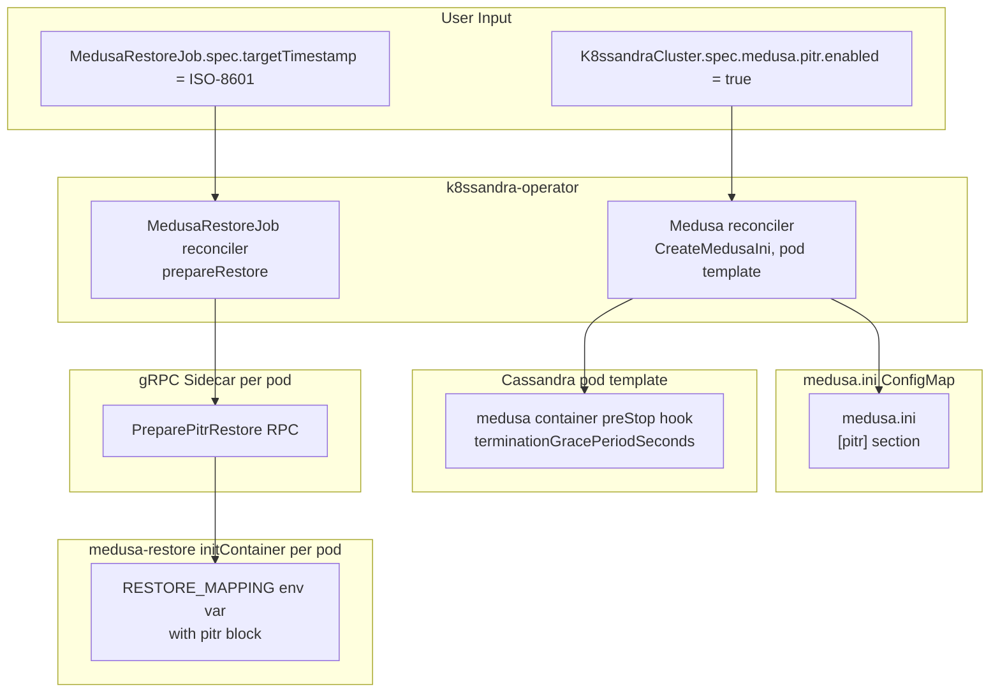
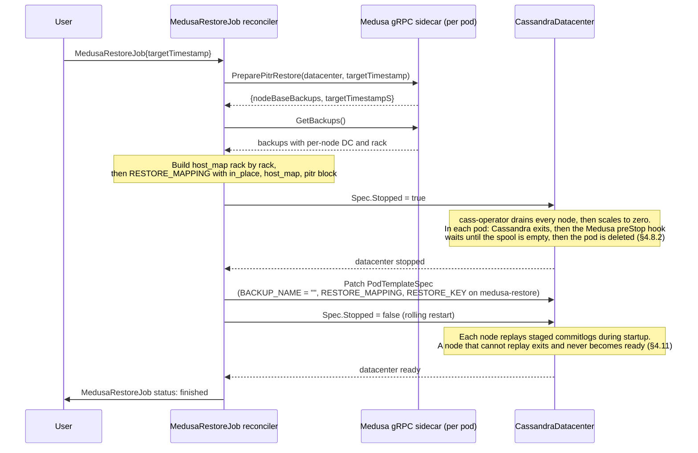

# Point-in-Time Recovery (PITR) for k8ssandra-operator

- **Author(s):** (your name)
- **Status:** Draft
- **Reviewers:**

---

## 1. Context and Scope

### Background

k8ssandra-operator manages Cassandra clusters on Kubernetes. It already orchestrates backups and restores through Medusa: the operator creates `MedusaBackupJob` and `MedusaRestoreJob` CRDs, drives the Medusa gRPC sidecar on each pod, and injects `RESTORE_MAPPING` into the `medusa-restore` initContainer as an env var.

Medusa is gaining PITR support — continuous archiving of Cassandra commitlog segments and a `PreparePitrRestore` RPC that resolves per-node base backups for a given target timestamp. The full Medusa contract is described in [`cassandra-medusa/docs/superpowers/specs/pitr-design-doc.md`](../../cassandra-medusa/docs/superpowers/specs/pitr-design-doc.md).

The operator's role is narrowly defined:

1. Let the user **enable PITR** by setting it in the Medusa config (which the operator renders into `medusa.ini` via a ConfigMap).
2. Let the user **execute a PITR restore** by specifying a `targetTimestamp` on `MedusaRestoreJob` instead of a backup name.
3. **Keep the archived stream complete when a pod stops.** With archiving on, a pod must upload the commitlog segments still in its spool before it is deleted. The operator arranges this with a `preStop` hook on the Medusa container (§4.8.2). An in-place PITR restore relies on it (§4.7.5).

The operator is already widely deployed. Every change must be additive and optional. Users who do not opt in must see zero behaviour change.

### Problem Statement

Today, `MedusaRestoreJob` requires a `spec.backup` name. There is no way to say "restore to 14:23:05 on Tuesday." Enabling archiving requires hand-editing the ConfigMap that Medusa reads.

### Why Now

Medusa's gRPC server now exposes `PreparePitrRestore`. The operator can wire that RPC into the existing reconcile pattern with minimal new surface area. Medusa also exposes `GetCommitLogArchiveStatus`; the operator does not call it (§7 item 1).

### Scope

**In scope:**
- A new optional `pitr` field on `MedusaClusterTemplate` that maps to the `[pitr]` section in `medusa.ini`.
- A new optional `targetTimestamp` field on `MedusaRestoreJobSpec`. Setting it triggers the PITR restore path.
- In `RestoreJobController`, calling `PreparePitrRestore` when `targetTimestamp` is set and building the host map from its result. Pod names may differ from the source (§4.7).
- A `preStop` hook on the Medusa container and a longer termination grace period, set when `pitr.enabled` is true, so that every pod uploads its remaining commitlog segments before it stops (§4.8.2). An in-place PITR restore depends on it (§4.7.5).
- A `pitr` block in `MedusaRestoreMapping` (`RESTORE_MAPPING`), read by Medusa's initContainer (§4.3.3).
- Regenerating Go gRPC stubs from the updated `medusa.proto`.
- Unit and integration tests covering the new paths, with zero regressions on existing paths.

**Out of scope:**
- Cross-DC PITR restore. The restore orchestration is strictly cluster-local; a `MedusaRestoreJob` always targets a single `CassandraDatacenter`.
- Cross-topology PITR restore. The target DC must have the same rack names and the same node count per rack as the source. Commitlog streams are per node and cannot be split or merged (Medusa spec, NG1).
- Managing `commitlog_archiving.properties` directly — Medusa's initContainer owns that file.
- Starting or stopping Cassandra — cass-operator handles that.
- New CLI commands or new CRDs — all changes extend existing objects.
- Archiving health reporting. The operator never calls `GetCommitLogArchiveStatus` and holds no archiving status. Moved out of scope on 2026-10-27 (§7 item 1).
- Timeline floor across repeated PITR restores. A later PITR of the same DC can replay commitlogs from the discarded timeline. A separate, parallel effort handles it. The final upload before a pod stops (§4.8.2) does not replace it.

---

## 2. Goals and Non-Goals

### Goals

- **G1:** Users enable PITR by setting one field (`spec.medusa.pitr.enabled: true`) on an existing CRD. No new CRD, no new controller, no new sidecar.
- **G2:** `pitr.enabled: false` (the default) produces zero behaviour change — existing backup, restore, and purge flows are untouched.
- **G3:** A PITR restore is driven through the same `MedusaRestoreJob` object and the same rolling-restart machinery that backup restores use today.
- **G4:** The operator never needs direct knowledge of commitlog internals. All PITR-specific logic runs inside Medusa; the operator only passes a timestamp and routes the result.
- **G5:** Removed on 2026-10-27. Archiving health reporting is out of scope (§7 item 1). The number is kept so that references stay valid.
- **G6:** A PITR restore can target a DC whose pod names differ from the source, as long as the DC name, rack names, and node count per rack match. This is the same rule as for backup restores today. Such a target does not need `pitr.enabled` set: it may be a disaster recovery cluster while the source is gone. The base backups must have been taken with `pitr.enabled` on (§4.10 item 1). It must read the source's backups: set `storageProperties.prefix` to the source's prefix (the default prefix is the cluster name), and use a different cluster name, or the pod names equal the source's and the restore is in place.

### Non-Goals

- **NG1:** Providing a use-case path for recovering individual tables or keyspaces — PITR targets the full cluster state at a point in time.
- **NG2:** Recovering to a timestamp that falls before any available base backup — the operator surfaces a clear error; it does not synthesise missing data.
- **NG3:** UI or CLI tooling beyond the CRD surface; all interaction is through Kubernetes objects.

### Success Criteria

| # | Criterion | How verified |
|---|---|---|
| SC1 | `pitr.enabled: true` in `K8ssandraCluster` causes the operator to emit a `[pitr]` section in `medusa.ini`; `pitr.enabled: false` (or absent) produces no `[pitr]` section | Unit test on `CreateMedusaIni` |
| SC2 | A `MedusaRestoreJob` with `targetTimestamp` set calls `PreparePitrRestore`, sets the `pitr` block in `RESTORE_MAPPING`, and completes the rolling restart | Integration test |
| SC3 | A `MedusaRestoreJob` with both `backup` and `targetTimestamp` set is rejected by the webhook | Webhook unit test |
| SC4 | A `MedusaRestoreJob` without `targetTimestamp` follows the existing code path with no behaviour change | Existing test suite; zero new failures |
| SC6 | A `MedusaRestoreJob` with `targetTimestamp` on a DC whose pod names differ from the backup's node names produces a `RESTORE_MAPPING` with `in_place: false` and a `host_map` from each target pod to its source node | Unit test on `GetPitrHostMap` |
| SC7 | Medusa has no Kubernetes API dependency; the operator has no caller of `GetCommitLogArchiveStatus` | Code review |
| SC10 | A change to `spec.medusa.pitr` changes the Cassandra pod template; a cluster without `pitr` gets no new template annotation | Unit test on `UpdateMedusaInitContainer` |

SC5, SC8, and SC9 were removed on 2026-10-27 with the archiving status surface (§7 item 1). The remaining numbers are unchanged so that the tickets stay valid.

---

## 3. Overview (Executive Summary)

The feature has three parts:

1. **Config surface (`pitr` field on `MedusaClusterTemplate`):** A new optional `Pitr *PitrConfig` field. When set and `Enabled: true`, `CreateMedusaIni` renders a `[pitr]` section in the `medusa.ini` ConfigMap. The operator exposes three of Medusa's five `[pitr]` keys: `enabled`, `commitlog_archive_interval_seconds`, and `commitlog_spool_dir`. The staging directory and the restore grace period keep Medusa's defaults. When `Pitr` is nil or `Enabled` is false (the default), no `[pitr]` section is emitted.

2. **PITR restore path (`targetTimestamp` on `MedusaRestoreJobSpec`):** When `targetTimestamp` is set, the restore reconciler:
   1. Calls `PreparePitrRestore(datacenter, targetTimestamp)` on one Medusa sidecar, for the DC named in `spec.cassandraDatacenter`. Medusa picks, per node, the latest backup taken with PITR enabled before the timestamp. If any node has none, the job fails and nothing is touched.
   2. Builds the host map from the returned nodes and `GetBackups`, as for a backup restore. Pod names may differ from the source (`in_place: false`). Assembles `RESTORE_MAPPING` with the `pitr` block.
   3. Does not wait on anything new before the stop. When the datacenter stops, cass-operator drains every node, and each pod with archiving on uploads the segments left in its spool before it is deleted. This is a property of the pod template (§4.8.2), not of the reconciler (§4.7.5).
   4. Stops the datacenter, patches the restore initContainer, and starts the datacenter again. Each initContainer restores its base SSTables and stages commitlogs for replay up to the target.
   5. Waits for the `CassandraDatacenter` to become `Ready`, then sets `FinishTime`. Cassandra replays the staged commitlogs during startup and exits if it cannot. A node that cannot replay never becomes ready, so the job never completes. After 60 minutes without a ready DC, `Status.Message` says the restore may be stuck in replay (§4.7.9, §4.11).

   A failure that a retry cannot fix sets `FinishTime` and `Message`, and the job is never reconciled again (§4.7.8). Details in §4.7.

3. **Pod template changes for `pitr`:** When `spec.medusa.pitr` is set, the operator adds a hash annotation to the Cassandra pod template, so that any change to the block rolls the pods (§4.8.1). When `pitr.enabled` is true, it also adds a `preStop` hook to the Medusa container and raises the pod's termination grace period (§4.8.2). The hook waits until the Cassandra container has exited and the spool directory is empty. So a pod never dies with a sealed segment that is not in the bucket, whether it stops for a restore or for any other reason. The operator reads no archiving status (§7 item 1).

The design is purely additive. Existing backup, restore, and purge flows are unchanged when `targetTimestamp` is absent and `pitr.enabled` is false. Commitlog purge is handled entirely inside Medusa's own `purge_commitlogs` function, invoked during the existing `medusa purge` command — no operator changes are required for purge.

---

## 4. Proposed Architecture & Detailed Design

### 4.1 System Architecture



**Restore sequence with `targetTimestamp`:**



### 4.2 Complete File Map

| File | Change | Responsibility |
|---|---|---|
| [`apis/medusa/v1alpha1/medusa_types.go`](../../apis/medusa/v1alpha1/medusa_types.go) | Modify | Add `Pitr *PitrConfig` to `MedusaClusterTemplate`; add `PitrConfig` struct |
| [`apis/medusa/v1alpha1/medusarestorejob_types.go`](../../apis/medusa/v1alpha1/medusarestorejob_types.go) | Modify | Add `TargetTimestamp string` to `MedusaRestoreJobSpec`; make `Backup` optional; add `Pitr *PitrRestoreBlock` to `MedusaRestoreMapping`; add `DatacenterStarted` to `MedusaRestoreJobStatus` (§4.7.9) |
| [`apis/medusa/v1alpha1/zz_generated.deepcopy.go`](../../apis/medusa/v1alpha1/zz_generated.deepcopy.go) | Re-generate | Deep copy for `PitrConfig` and `PitrRestoreBlock` |
| [`pkg/medusa/reconcile.go`](../../pkg/medusa/reconcile.go) | Modify | Extend `CreateMedusaIni` to render `[pitr]` section when `pitr.enabled = true`; set the `k8ssandra.io/medusa-pitr-hash` pod template annotation in `UpdateMedusaInitContainer` when `pitr` is set (§4.8.1); add the Medusa container `preStop` hook and the termination grace period when `pitr.enabled` is true (§4.8.2) |
| [`pkg/medusa/reconcile_test.go`](../../pkg/medusa/reconcile_test.go) | Modify | Tests for the `[pitr]` section, the hash annotation, the `preStop` hook, and the grace period (§6.5) |
| [`pkg/medusa/hostmap.go`](../../pkg/medusa/hostmap.go) | Modify | Split `GetHostMap` into `getSourceRacks` and `buildHostMap`; add `GetPitrHostMap` that takes the source nodes from `nodeBaseBackups` |
| [`pkg/medusa/hostmap_test.go`](../../pkg/medusa/hostmap_test.go) | Modify | Tests for `GetPitrHostMap` (in place, out of place, mismatches) and the `buildHostMap` fixes; `mockgRPCClient` implements the new `Client` method |
| `pkg/medusa/errors.go` | New | `TerminalError` type returned by `preparePitrRestore` and `GetPitrHostMap` for failures that must not be retried (§4.7.8) |
| [`controllers/medusa/medusabackupjob_controller_test.go`](../../controllers/medusa/medusabackupjob_controller_test.go) | Modify | `fakeMedusaClient` implements the new `Client` method, or the package does not compile |
| `config/crd/bases/*.yaml`, `charts/k8ssandra-operator/crds/*.yaml` | Re-generate | `make manifests`: `backup` optional, new spec and status fields |
| [`pkg/medusa/grpc.go`](../../pkg/medusa/grpc.go) | Modify | Add `PreparePitrRestore` to `Client` interface and `defaultClient` |
| [`pkg/medusa/medusa.proto`](../../pkg/medusa/medusa.proto) | Modify | Add `GetCommitLogArchiveStatus` and `PreparePitrRestore` RPCs and message types, as in Medusa's proto (additive only). Only `PreparePitrRestore` gets a `Client` wrapper |
| [`pkg/medusa/medusa.pb.go`](../../pkg/medusa/medusa.pb.go) | Re-generate | Protobuf generated code |
| [`pkg/medusa/medusa_grpc.pb.go`](../../pkg/medusa/medusa_grpc.pb.go) | Re-generate | gRPC generated code |
| [`controllers/medusa/medusarestorejob_controller.go`](../../controllers/medusa/medusarestorejob_controller.go) | Modify | Add PITR branch in `prepareRestore`; extend `podTemplateSpecUpdateComplete` and `updateMedusaRestoreInitContainer`; add `validateRestoreSpec`; map `TerminalError` to a failed job; skip finished jobs (§4.7.8); add the stuck-replay notice (§4.7.9) |
| [`controllers/medusa/medusarestorejob_controller_test.go`](../../controllers/medusa/medusarestorejob_controller_test.go) | Modify | Add PITR restore test cases |
| `apis/medusa/v1alpha1/medusarestorejob_webhook.go` | New | Validating webhook: exactly one of `backup` / `targetTimestamp`; `targetTimestamp` parses. No MedusaRestoreJob webhook exists today |
| `apis/medusa/v1alpha1/medusarestorejob_webhook_test.go` | New | Webhook unit tests (SC3) |
| [`main.go`](../../main.go) | Modify | Register the MedusaRestoreJob webhook, next to `SetupMedusaBackupScheduleWebhookWithManager` |
| `config/webhook/manifests.yaml` | Re-generate | `make manifests` picks up the new `+kubebuilder:webhook` marker |

### 4.3 API Changes

#### 4.3.1 `PitrConfig` on `MedusaClusterTemplate`

A new optional struct mirroring Medusa's `[pitr]` section:

```go
// PitrConfig configures Medusa's PITR commitlog archiving.
// Rendered as a [pitr] section in medusa.ini when Enabled is true.
type PitrConfig struct {
    // Enabled turns on continuous commitlog archiving.
    // Defaults to false.
    // +kubebuilder:default=false
    Enabled bool `json:"enabled"`

    // ArchiveIntervalSeconds is how often the commitlog spool is drained to object storage.
    // Defaults to Medusa's built-in default (60s) when absent.
    // +optional
    ArchiveIntervalSeconds *int `json:"archiveIntervalSeconds,omitempty"`

    // SpoolDir is the local directory where Cassandra hardlinks finalized commitlog segments.
    // Must be on the same filesystem as the Cassandra commitlog directory.
    // Defaults to Medusa's buil-in default /var/lib/cassandra/commitlog_spool_dir when absent.
    // +optional
    SpoolDir string `json:"spoolDir,omitempty"`
}
```

Added to `MedusaClusterTemplate`:

```go
// Pitr configures Point-in-Time Recovery commitlog archiving.
// Leave nil or set Enabled=false (the default) for no behaviour change.
// +optional
Pitr *PitrConfig `json:"pitr,omitempty"`
```

#### 4.3.2 `targetTimestamp` on `MedusaRestoreJobSpec`

```go
type MedusaRestoreJobSpec struct {
    // The name of the MedusaBackup to restore.
    // Mutually exclusive with TargetTimestamp. One of the two must be set.
    // +optional
    Backup string `json:"backup,omitempty"`

    // Name of the Cassandra datacenter to perform the restore on.
    CassandraDatacenter string `json:"cassandraDatacenter"`

    // TargetTimestamp is the point in time to restore to. Accepts ISO-8601 (UTC)
    // or a Unix epoch float string. Mutually exclusive with Backup.
    // The base backups must have been taken with pitr.enabled=true.
    // +optional
    TargetTimestamp string `json:"targetTimestamp,omitempty"`
}
```

**Validation rule** (webhook): exactly one of `backup` and `targetTimestamp` must be non-empty. If both or neither are set, the webhook rejects the object.

#### 4.3.3 `PitrRestoreBlock` in `MedusaRestoreMapping`

The existing `MedusaRestoreMapping` struct gains an optional `Pitr` field:

```go
type MedusaRestoreMapping struct {
    // Whether the restore is in-place or not
    // +optional
    InPlace *bool `json:"in_place"`

    // Mapping between source and target nodes for a restore
    HostMap map[string]MappingSource `json:"host_map,omitempty"`

    // Pitr contains PITR-specific restore parameters.
    // Present only for PITR restores; absent for backup restores.
    // +optional
    Pitr *PitrRestoreBlock `json:"pitr,omitempty"`
}

// PitrRestoreBlock is the pitr sub-object inside RESTORE_MAPPING.
// It is read by Medusa's pitr_restore.py to determine which commitlog segments
// to download and what timestamp to replay to.
type PitrRestoreBlock struct {
    // TargetTimestampS is the Unix epoch float timestamp to restore to.
    TargetTimestampS float64 `json:"target_timestamp_s"`

    // NodeBackups maps each node FQDN to the base backup name selected by PreparePitrRestore.
    NodeBackups map[string]string `json:"node_backups"`
}
```

For a PITR restore, the operator computes `in_place` and `host_map` the same way as for a backup restore. The keys of `pitr.node_backups` are source node names, as returned by `PreparePitrRestore`. Each pod resolves its source node from `host_map[POD_NAME].source[0]` and then finds its base backup in `pitr.node_backups[source]`. The same JSON is set on every pod.

Example for an out-of-place restore of a three-node DC. An in-place restore differs only in `in_place: true` and an identity `host_map` (Medusa spec, §4.7):

```json
{
  "in_place": false,
  "host_map": {
    "node1-new.fqdn": {"source": ["node1.fqdn"], "seed": false},
    "node2-new.fqdn": {"source": ["node2.fqdn"], "seed": false},
    "node3-new.fqdn": {"source": ["node3.fqdn"], "seed": false}
  },
  "pitr": {
    "target_timestamp_s": 1721000000.0,
    "node_backups": {
      "node1.fqdn": "backup-20240715-node1",
      "node2.fqdn": "backup-20240715-node2",
      "node3.fqdn": "backup-20240715-node3"
    }
  }
}
```

### 4.4 `medusa.proto` Changes

Two new RPCs are added to the `Medusa` service (additive — no existing RPCs or field numbers changed):

```protobuf
rpc GetCommitLogArchiveStatus(GetCommitLogArchiveStatusRequest)
    returns (GetCommitLogArchiveStatusResponse);

rpc PreparePitrRestore(PreparePitrRestoreRequest)
    returns (PreparePitrRestoreResponse);

message GetCommitLogArchiveStatusRequest {}

message GetCommitLogArchiveStatusResponse {
  bool       running         = 1;
  int64      lastUploadTime  = 2;
  int32      pendingCount    = 3;
  int32      intervalSeconds = 4;
  StatusType status          = 5;
  string     lastError       = 6;
}

message PreparePitrRestoreRequest {
  string targetTimestamp = 1;
  string datacenter      = 2;  // Cassandra DC name of MedusaRestoreJob.spec.cassandraDatacenter (§4.10 item 7)
}

message PreparePitrRestoreResponse {
  StatusType          status          = 1;
  map<string, string> nodeBaseBackups = 2;
  double              targetTimestampS = 3;
}
```

The `datacenter` field is not in the frozen Medusa spec; the operator needs it (§4.10 item 7). It mirrors `PrepareRestoreRequest.datacenter`. The response has no message text (§4.10 item 1). `GetCommitLogArchiveStatus` stays in the file so that it matches Medusa's proto. The operator has no caller for it (§7 item 1).

After editing `medusa.proto`, regenerate with:

```bash
protoc --go_out=. --go-grpc_out=. pkg/medusa/medusa.proto
```

### 4.5 `Client` Interface Extension

[`pkg/medusa/grpc.go`](../../pkg/medusa/grpc.go) — add one method to `Client`:

```go
type Client interface {
    Close() error
    CreateBackup(ctx context.Context, name string, backupType string) (*BackupResponse, error)
    GetBackups(ctx context.Context) ([]*BackupSummary, error)
    PurgeBackups(ctx context.Context) (*PurgeBackupsResponse, error)
    PrepareRestore(ctx context.Context, datacenter, backupName, restoreKey string) (*PrepareRestoreResponse, error)
    BackupStatus(ctx context.Context, backupName string) (*BackupStatusResponse, error)

    // New: PITR
    PreparePitrRestore(ctx context.Context, datacenter, targetTimestamp string) (*PreparePitrRestoreResponse, error)
}
```

The implementation on `defaultClient` is a single-line wrapper, identical in style to the existing methods. No wrapper is added for `GetCommitLogArchiveStatus`; the operator has no caller for it (SC7).

### 4.6 `CreateMedusaIni` Extension

[`pkg/medusa/reconcile.go`](../../pkg/medusa/reconcile.go) — extend the Go template to emit the `[pitr]` block when `spec.medusa.pitr.enabled = true`:

```go
    {{- if and .Spec.Medusa.Pitr .Spec.Medusa.Pitr.Enabled }}

    [pitr]
    enabled = true
    {{- if .Spec.Medusa.Pitr.ArchiveIntervalSeconds }}
    commitlog_archive_interval_seconds = {{ .Spec.Medusa.Pitr.ArchiveIntervalSeconds }}
    {{- end }}
    {{- if .Spec.Medusa.Pitr.SpoolDir }}
    commitlog_spool_dir = {{ .Spec.Medusa.Pitr.SpoolDir }}
    {{- end }}
    {{- end }}
```

When `Pitr` is nil or `Enabled` is false, no `[pitr]` section is emitted; Medusa defaults to `pitr.enabled = false`.

`text/template` dereferences the `*int` when it prints it. The template has no `FuncMap`, and `CreateMedusaIni` panics on a parse error, so no custom function may be used.

### 4.7 Restore Reconciler — PITR Branch & Fail-Fast Strategy

[`controllers/medusa/medusarestorejob_controller.go`](../../controllers/medusa/medusarestorejob_controller.go) — The PITR restore path must fail as early as possible. If any node lacks a base backup taken with PITR enabled before the target, the restore cannot execute. The reconciler aborts before stopping Cassandra and before patching pod specs.

#### 4.7.1 Pre-flight validation & request construction

1. **`NewMedusaRestoreRequest`**:
   - For backup restore (`spec.backup != ""`), it fetches the `MedusaBackup` CR.
   - For PITR restore (`spec.targetTimestamp != ""`), `spec.backup` is empty. `NewMedusaRestoreRequest` skips the `MedusaBackup` CR fetch and leaves `req.MedusaBackup` nil.
   - `req.MedusaBackup` is used in exactly three places today. Each one must branch on `spec.targetTimestamp`:

     | Site | Backup restore | PITR restore |
     |---|---|---|
     | `Reconcile`, `validateBackupForRestore(request.MedusaBackup, cassdc)` (line 114) | unchanged | skipped |
     | `podTemplateSpecUpdateComplete`, `req.MedusaBackup.Name` (line 257) | unchanged | check `RESTORE_MAPPING` instead (see below) |
     | `updateMedusaRestoreInitContainer`, `setBackupNameInRestoreContainer(req.MedusaBackup.Name, ...)` (line 375) | unchanged | called with `""` (§4.7.7) |

2. **`validateRestoreSpec`**:
   - Rejects specs where both `backup` and `targetTimestamp` are set, or where neither is set.
   - Validates that `targetTimestamp` parses as ISO-8601 UTC or Unix epoch float string.

3. **No `K8ssandraCluster` read.** `MedusaRestoreJobReconciler` runs in the data plane. The `K8ssandraCluster` object lives in the control plane only (`main.go` registers `K8ssandraClusterReconciler` under `isControlPlane()` and the Medusa controllers outside it). So a DP reconciler cannot read `spec.medusa.pitr`, and it does not need to. Whether PITR was enabled at backup time is Medusa's check in `PreparePitrRestore` (§4.10 item 1), for every PITR restore. Whether the target archives now is checked by nobody. If it does, its pods carry the `preStop` hook of §4.8.2 and upload their spools before they stop. If it does not, there is no spool to upload. The reconciler never reads archiver status (§7 item 1).

#### 4.7.2 `prepareRestore` — Fail-Fast Base Backup Verification

`prepareRestore` executes before `request.RestoreJob.Status.RestorePrepared` is set to `true`, and before `request.Datacenter.Spec.Stopped` is set to `true`.

```go
func (r *MedusaRestoreJobReconciler) prepareRestore(
    ctx context.Context, request *medusa.RestoreRequest, logger logr.Logger,
) (*medusav1alpha1.MedusaRestoreMapping, error) {

    pods, err := medusa.GetCassandraDatacenterPods(ctx, request.Datacenter, r, request.Log)
    if err != nil {
        return nil, err
    }

    for _, pod := range pods {
        client, err := newClient(ctx, r.Client, request.Datacenter, ptr.To(pod), r.ClientFactory)
        if err != nil {
            logger.Error(err, "Failed to create Medusa client", "Pod", pod.Name)
            continue
        }

        if request.RestoreJob.Spec.TargetTimestamp != "" {
            // PITR path: Medusa picks the base backups, the operator builds the host map
            return r.preparePitrRestore(ctx, request, client, logger)
        }

        // Existing backup path
        hostMap, err := medusa.GetHostMap(request.Datacenter, *request.RestoreJob, client, ctx)
        if err != nil {
            return nil, err
        }
        mapping, err := hostMap.ToMedusaRestoreMapping()
        if err != nil {
            return nil, err
        }
        return &mapping, nil
    }

    return nil, fmt.Errorf("no reachable Medusa sidecar found")
}
```

#### 4.7.3 `preparePitrRestore`

`PreparePitrRestore` is read-only (§4.10 item 1). For every node of the DC (§4.10 item 7), Medusa picks the latest backup that carries the snapshot-time marker and has `snapshot_time <= target_timestamp_s` (`select_node_base_snapshot`). The marker is written only when `pitr.enabled` was on at backup time, so this is the PITR enablement gate. It holds for in-place and out-of-place restores alike. If any node has no such backup, it returns `StatusType_FAILED`. The response has no text field, so the operator cannot name the node.

On `FAILED`, on gRPC `UNIMPLEMENTED`, and on a host map mismatch, `preparePitrRestore` returns a `medusa.TerminalError`. `Reconcile` turns it into a failed job (§4.7.8): `RestorePrepared` stays `false` and the DC is never stopped. Other errors (network, pod not ready) are returned as today, and controller-runtime retries them with backoff. On success, the operator builds the host map with `GetPitrHostMap`, attaches the `pitr` block, and sets `RestorePrepared = true`.

```go
func (r *MedusaRestoreJobReconciler) preparePitrRestore(
    ctx context.Context,
    request *medusa.RestoreRequest,
    client medusa.Client,
    logger logr.Logger,
) (*medusav1alpha1.MedusaRestoreMapping, error) {

    // The DC comes from MedusaRestoreJob.spec.cassandraDatacenter, resolved to its Cassandra DC name,
    // the same value getSourceRacks filters on.
    resp, err := client.PreparePitrRestore(ctx, request.Datacenter.DatacenterName(), request.RestoreJob.Spec.TargetTimestamp)
    if status.Code(err) == codes.Unimplemented {
        return nil, medusa.Terminal(fmt.Errorf("Medusa does not support PITR; upgrade the Medusa image"))
    }
    if err != nil {
        return nil, fmt.Errorf("PreparePitrRestore gRPC call failed: %w", err) // transient: retried
    }
    if resp.Status == medusa.StatusType_FAILED {
        return nil, medusa.Terminal(fmt.Errorf("no eligible base backup for at least one node before timestamp %s", request.RestoreJob.Spec.TargetTimestamp))
    }

    // Same rack-by-rack pairing as a backup restore. A mismatch is a TerminalError,
    // raised before the DC is stopped. Pod names may differ (in_place = false).
    hostMap, err := medusa.GetPitrHostMap(request.Datacenter, resp.NodeBaseBackups, client, ctx)
    if err != nil {
        return nil, err
    }
    mapping, err := hostMap.ToMedusaRestoreMapping()
    if err != nil {
        return nil, err
    }
    mapping.Pitr = &medusav1alpha1.PitrRestoreBlock{
        TargetTimestampS: resp.TargetTimestampS,
        NodeBackups:      resp.NodeBaseBackups, // keyed by source node name
    }
    return &mapping, nil
}
```

#### 4.7.4 Host map for PITR

`PreparePitrRestore` returns `{sourceNode: backupName}` with no rack or DC. `GetHostMap` cannot be reused as is, because it takes the source nodes from the one backup in `spec.backup`. The pairing logic in [`pkg/medusa/hostmap.go`](../../pkg/medusa/hostmap.go) is split out and shared:

- `getSourceRacks(nodes []*BackupNode, dcName)` groups backup nodes by rack and drops nodes of other DCs. It is the existing body of `getSourceRacksIPs` after the backup lookup.
- `buildHostMap(sourceRacks, cassDC)` is the existing pairing loop of `GetHostMap` with two fixes. It sorts racks by name, requires the same rack count and the same rack names, requires the same DC name, and pairs node `j` of source rack `i` with pod `j` of target rack `i`. Fix one: the rack name check is new. Today only the count is compared; names are checked only by `validateBackupForRestore`, which the PITR path skips. Fix two: a source rack with more nodes than its target rack returns an error. Today the check is `j > destRack.Size`, so the loop indexes `destRack.Nodes[j]` out of range and panics before it can return; it becomes `j >= destRack.Size`.
- `GetHostMap` (backup restore) = look up `spec.backup` in `GetBackups`, then `getSourceRacks` and `buildHostMap`. Behaviour is unchanged, except that the panic above becomes an error and rack names are checked twice.
- `GetPitrHostMap(cassDC, nodeBackups, client, ctx)` (PITR) = call `GetBackups` once; for each `(node, backupName)` in `nodeBackups`, find backup `backupName` and its `BackupNode` with `host == node` to get rack and DC; then `getSourceRacks` and `buildHostMap`. It also requires that every target pod got a source: `len(hostMap)` must equal the pod count of the DC. A missing backup, a missing node entry, or a count mismatch is an error. Every error from `GetPitrHostMap` is a `medusa.TerminalError`.

`ToMedusaRestoreMapping` then sets `in_place` to `true` only when every source name equals its target name. The operator never rewrites the keys of `pitr.node_backups`. They stay source names so that each pod can resolve them through `host_map`.

#### 4.7.5 Final upload before the datacenter stops

**Why:** Each pod holds sealed commitlog segments in its spool that are not in the bucket yet. Medusa's restore cleans the commitlog directory, but not the spool (Medusa spec §4.8). If a pod dies with a full spool, two things go wrong. The restore initContainer lists the bucket and never sees those segments, so the replay ends before the target. And the archiver uploads them after the restore, when they belong to the discarded timeline. A running node also keeps writing new segments. So new commitlogs must stop first, and the old ones must upload second.

**How:** The reconciler does nothing for this. It stops the datacenter as for a backup restore. The work happens in the pods: cass-operator drains every node before it scales the StatefulSets to zero (§4.11 item 9), and each pod's Medusa container carries a `preStop` hook that returns only after the Cassandra container has exited and the spool directory is empty (§4.8.2). The kubelet deletes the pod only then. The hook is part of the pod template whenever `pitr.enabled` is true, so it also covers every other pod stop: rolling restarts, node drains, manual deletes.

**Ordering:** `PreparePitrRestore` runs before the stop and lists no segments (Medusa spec §4.7). The segments are listed by `pitr_restore.py` in the restore initContainer (Medusa spec §4.8). A StatefulSet creates the new pod with ordinal N only after the old pod N is gone, so that initContainer runs after that pod's hook returned and its spool reached the bucket. No cross-pod barrier is needed: each pod replays only its own node's segments.

**What is not checked:** The reconciler does not check that the archiver runs, does not drain, does not poll a spool, and has no timeout of its own. Backup restores and out-of-place PITR restores get the same treatment. An out-of-place target has no spool of the source timeline; if it archives its own commitlogs, its pods run the same hook for their own segments, which belong to their own timeline and do not affect this restore. This replaced the operator-side drain gate on 2026-10-27 (§5 option F, §7 item 3).

**Failure:** If the hook does not finish inside the termination grace period, the kubelet kills the container and the pod gets a `FailedPreStopHook` warning event. The restore proceeds; the operator cannot see it. The segments left in the spool survive on the data volume, are missing from the replay, and are uploaded by the new sidecar after the restore. §6.4 has the row, and the readiness spec carries it as risk R2.

#### 4.7.6 `podTemplateSpecUpdateComplete` for PITR

The existing check verifies that `BACKUP_NAME` and `RESTORE_KEY` env vars have propagated to StatefulSets. For PITR, `BACKUP_NAME` is set to the empty string (§4.7.7) and `RESTORE_MAPPING` carries the mapping. `pkg/utils` has only `ContainerHasEnvVar(container, name, value)`, so the check compares against the marshalled mapping from the job status:

```go
for _, statefulset := range statefulsetList.Items {
    container := getRestoreInitContainerFromStatefulSet(&statefulset)
    if container == nil {
        return false, nil
    }

    if req.RestoreJob.Spec.TargetTimestamp != "" {
        // PITR restore: BACKUP_NAME cleared, RESTORE_MAPPING equal to the status mapping
        if !utils.ContainerHasEnvVar(container, backupNameEnvVar, "") {
            return false, nil
        }
        mappingJSON, err := json.Marshal(req.RestoreJob.Status.RestoreMapping)
        if err != nil {
            return false, err
        }
        if !utils.ContainerHasEnvVar(container, restoreMappingEnvVar, string(mappingJSON)) {
            return false, nil
        }
    } else {
        if !utils.ContainerHasEnvVar(container, backupNameEnvVar, req.MedusaBackup.Name) {
            return false, nil
        }
    }

    if !utils.ContainerHasEnvVar(container, restoreKeyEnvVar, req.RestoreJob.Status.RestoreKey) {
        return false, nil
    }
}
```

#### 4.7.7 `updateMedusaRestoreInitContainer` for PITR

When `targetTimestamp` is set:
- Call `setBackupNameInRestoreContainer("", cassdc)`. There is no single backup name. A value left by an earlier backup restore would otherwise open the entrypoint's `[ -n "$BACKUP_NAME" ]` gate (Medusa spec §4.8) and hide a missing §4.10 item 3.
- `setRestoreMappingInRestoreContainer` is called as today — with the mapping that now includes the `pitr` block.
- `setRestoreKeyInRestoreContainer` is called as today.

The `RESTORE_MAPPING` env var is set identically on every pod's initContainer (the existing `setRestoreMappingInRestoreContainer` function already marshals the full mapping struct — no change needed there, only the struct now carries the `pitr` field).

**Contracts with Medusa:** see §4.10 items 3 to 7.

#### 4.7.8 Terminal failures

A terminal failure is one that a retry cannot fix: no eligible base backup, Medusa too old, or a topology mismatch. Today `Reconcile` returns every `prepareRestore` error unchanged, so controller-runtime retries it with backoff forever. It also never checks `FinishTime`, so a job that was marked failed runs again on the next resync or operator restart.

- `pkg/medusa/errors.go` defines `TerminalError` (`type TerminalError struct{ Err error }` with `Error()` and `Unwrap()`) and `Terminal(err error) error`. `preparePitrRestore` and `GetPitrHostMap` return it for the cases above.
- `Reconcile` checks `errors.As(err, &terminal)` on the `prepareRestore` result. On a match it sets `Status.FinishTime`, sets `Status.Message` to the error text, applies updates, and returns `ctrl.Result{}, nil`. This is the path `validateBackupForRestore` uses today. Any other error is returned as today.
- `Reconcile` returns `ctrl.Result{}, nil` right after `NewMedusaRestoreRequest` when `Status.FinishTime` is set and `Status.Message` is not empty. `Message` is set on failure and by the stuck-replay notice (§4.7.9). The notice is cleared when `FinishTime` is set, so a successful job still reaches `RefreshSecrets` on a requeue as today.
- The backup restore path is not affected: `GetHostMap` errors stay plain errors.

#### 4.7.9 Completion

The operator marks a PITR restore complete the same way it marks a backup restore complete today. After the DC starts again, `Reconcile` requeues until `cassandra.DatacenterReady` is true, then sets `Status.FinishTime` ([`medusarestorejob_controller.go`](../../controllers/medusa/medusarestorejob_controller.go) lines 175 to 180). The operator does not probe replay progress, does not read Cassandra logs, and does not time out. The only addition is a stuck-replay notice, described below.

This is correct because of one guarantee: **Cassandra replays the staged commitlogs during startup, and a node that cannot replay them exits instead of serving.** §4.11 lists the facts behind it. For the job this means:

- `DatacenterReady` is set only after every pod is `Ready`, and a pod is `Ready` only after startup, which includes replay. So `FinishTime` means every node replayed its segments up to the target.
- A node that fails replay exits with code 3. The management API relaunches it in place every 30 seconds. Nothing re-runs the initContainer, so the properties file and the staged segments stay, and the node hits the same error again. The pod never becomes `Ready`, the DC never becomes `Ready`, and the job stays `InProgress` with no `FinishTime`. There is no timeout, as for a backup restore today. After 60 minutes the job carries the stuck-replay notice.
- The operator cannot name the failing node or the error. The user sees the DC not ready, the pod not ready, the notice in `Status.Message`, and `CommitLogReplayException` in the Cassandra log. The Medusa runbook (Medusa spec §6.6) covers remediation: a new `MedusaRestoreJob` with `backup` set to the base backup, or with an earlier `targetTimestamp`. The new job stops the DC as usual, which also ends the crash loop.

**Stuck-replay notice.** A replay that fails keeps the job `InProgress` with no signal on the job itself. The operator adds one, without a timeout:

- `MedusaRestoreJobStatus` gains `DatacenterStarted metav1.Time` (`json:"datacenterStarted,omitempty"`), next to `DatacenterStopped`. `Reconcile` sets it to `metav1.Now()` in the branch that sets `Datacenter.Spec.Stopped = false`.
- In the branch that waits for `DatacenterReady`, for a PITR job only (`spec.targetTimestamp != ""`), when `DatacenterStarted` is set and more than 60 minutes old and `Status.Message` is empty, `Reconcile` sets `Status.Message` to: `datacenter <name> is not ready 60 minutes after the restore started it; the PITR restore may be stuck in commitlog replay. Check the Cassandra log of the pods that are not ready for CommitLogReplayException. See the PITR user guide.` The job stays `InProgress`, `FinishTime` stays unset, and the reconciler keeps requeuing, because a slow but healthy replay must still finish.
- When `DatacenterReady` turns true, `Reconcile` clears `Status.Message` before it sets `FinishTime`, so the finished-job guard (§4.7.8) does not skip `RefreshSecrets`.
- The 60 minutes are a constant, not a field. It covers a rolling restart and a modest replay. A backup restore never gets the notice (G2).

The guarantee has holes that Cassandra does not close: a truncated last segment, a missing segment, a replay that the initContainer never armed, a pod recreated mid-replay, and two Cassandra settings that turn replay errors into log lines. §4.11 items 2, 4, 5, and 8 describe them. §4.10 items 3, 4, 6, 8, 9, and 10 state what Medusa must do about them. The operator adds no check for any of them. Each would need the operator to inspect data inside the pod, which the restore loop never does today.

### 4.8 Pod Template Changes for `pitr`

Two things in the Cassandra pod template depend on `spec.medusa.pitr`. Both are set by `pkg/medusa/reconcile.go` while it builds the Medusa containers, and both are absent when `pitr` is nil, so a cluster that does not opt in sees no template change (G2, SC10).

#### 4.8.1 Pod restart on a `pitr` change

Archiving is armed at pod start only. The initContainer writes `archive_command` into `commitlog_archiving.properties` when `pitr.enabled` is true (Medusa spec §4.3), Cassandra reads that file once when its commit log starts, and Medusa starts its archiver thread in `Server.serve()`. The operator writes only the `medusa.ini` ConfigMap, and nothing restarts the pods when a ConfigMap changes. So a change to `spec.medusa.pitr` on a running cluster would otherwise take effect only at the next unrelated restart, and until then the pod archives nothing.

To close this, `UpdateMedusaInitContainer` in `pkg/medusa/reconcile.go` sets the pod template annotation `k8ssandra.io/medusa-pitr-hash` to a hash of `spec.medusa.pitr`, with the hash function `annotations.AddHashAnnotation` uses, and only when `spec.medusa.pitr` is non-nil. A changed annotation changes the `CassandraDatacenter` pod template, and cass-operator rolls the pods as it does for any template change. A cluster without `pitr` gets no annotation, so G2 holds. Removing the `pitr` block removes the annotation, which also rolls the pods and disarms archiving. The first enablement usually comes with a Medusa image bump, which rolls the pods anyway; the annotation makes the later toggles behave the same. The hook and grace period of §4.8.2 also change the template, but the annotation is the rule the user can count on: any change to the block rolls the pods.

#### 4.8.2 Final upload before a pod stops

**What:** When `pitr.enabled` is true, `CreateMedusaMainContainer` sets a `preStop` hook on the `medusa` container, and the pod template gets a longer `terminationGracePeriodSeconds`. Neither is set otherwise, and cass-operator then applies its default grace period of 120 s (§4.11 item 9).

**The hook.** It is an `exec` action that runs `python3` from the Medusa image with two arguments: the management API port and the spool directory. The script has two loops, one second apart:

1. Until a TCP connect to `127.0.0.1:<port>` is refused. The management API is the main process of the `cassandra` container. While it listens, Cassandra may still run `archive_command` and put a segment into the spool. When the port closes, the container has exited and nothing can arrive in the spool any more (§4.11 item 9).
2. Until the spool directory has no entries. A directory that does not exist counts as empty. The Medusa process is still running during the hook, and its archiver thread keeps uploading on its interval and removes each hardlink after a successful upload (Medusa spec §4.4). So the loop ends on the first tick after the last upload.

Then the hook returns, the kubelet sends `SIGTERM` to the Medusa process, and the pod is deleted when both containers are gone. A plain TCP connect is used, not an HTTP call, so the hook does not depend on the management API's TLS mode. The port is resolved as cass-operator resolves it for its own drain hook, with `httphelper.GetMgmtApiPort` on the pod template's containers, which falls back to 8080. The spool directory is `spec.medusa.pitr.spoolDir`, or Medusa's default `/var/lib/cassandra/commitlog_spool_dir` when unset (§4.3.1); the operator holds that default in one constant (§4.10 item 2). The Medusa image has `python3` because Medusa is a Python application; nothing else is required from the image. The hook, the port, and the path are visible in the pod spec.

Reference script, passed as one `-c` argument:

```python
import os, socket, sys, time
port, spool = int(sys.argv[1]), sys.argv[2]
def cassandra_up():
    try:
        socket.create_connection(("127.0.0.1", port), timeout=1).close()
        return True
    except OSError:
        return False
while cassandra_up():
    time.sleep(1)
while os.path.isdir(spool) and os.listdir(spool):
    time.sleep(1)
```

**Why the order matters.** The two containers get their `preStop` hooks at the same time when the pod is deleted. The `cassandra` container's hook is cass-operator's drain call (§4.11 item 9). Drain flushes the memtables, recycles the active commitlog segment, and waits for `archive_command` on it, so the last segment lands in the spool during the drain. A hook that only checked the spool could see it empty before that segment arrives, return, and let the Medusa process die with the segment still in the spool. Waiting for the Cassandra container to exit first closes that window.

**Grace period.** The hook's run time counts against the pod's grace period, and whatever remains is the `SIGTERM` budget of the two containers. cass-operator's default of 120 s covers a drain and a Cassandra exit. The hook adds up to one archive interval of waiting for the next tick, plus the upload. So when `pitr.enabled` is true the operator sets `terminationGracePeriodSeconds` to `120 + 2 × interval`, with `interval` equal to `spec.medusa.pitr.archiveIntervalSeconds` or 60 when unset. The default is 240 s. The value is not a user field; if a user with slow object storage reports hook timeouts, exposing it is the follow-up (§7 item 3). The field is set only when `pitr.enabled` is true; otherwise it is left nil and cass-operator applies its default, so clusters without `pitr` are unchanged.

**What the hook costs.** Every pod stop with archiving on takes up to the hook's wait longer: a rolling restart of N pods adds up to N times one interval plus upload time, because cass-operator restarts one pod at a time. If the kubelet restarts only the Medusa container, for example on a liveness probe failure, the hook runs while Cassandra keeps running, never sees the port close, and the restart waits for the whole grace period. This is accepted; §6.4 has the row.

**When the hook does not finish.** The kubelet kills the container when the grace period ends, and the pod gets a `FailedPreStopHook` warning event. The segments stay in the spool on the data volume and are uploaded when the sidecar is back. For a plain restart this is only a delay. For an in-place PITR restore it is the failure case of §4.7.5. The operator reads nothing from the pod and cannot report it (§7 item 1); the event is the signal.

**Not a Medusa change.** The hook relies only on behaviour the Medusa spec already states: the spool is the only place a sealed segment waits, and a hardlink is removed only after a successful upload (§4.10 item 2). Medusa needs no new RPC, flag, or signal handler for it.

### 4.9 Extend-in-Place Strategy

All changes follow the "extend in place" principle:

- `MedusaRestoreJobSpec.Backup` changes from `required` to `optional` (one of `backup`/`targetTimestamp` required by webhook, not by schema). **This is the only breaking schema change.** Existing objects already have `backup` set; the omitempty tag ensures they continue to marshal correctly.
- `MedusaRestoreMapping` gains an optional `pitr` field with `omitempty`. Existing marshalled JSON is unaffected.
- `MedusaClusterTemplate` gains an optional `pitr` field. Absent = disabled.
- The restore reconciler's existing DC stop/start/wait logic is reused. `Reconcile` gains a finished-job guard and the `TerminalError` mapping (§4.7.8).
- `GetHostMap` keeps its signature. Its rack-pairing body moves to `buildHostMap`, shared with `GetPitrHostMap` (§4.7.4), which also turns a panic into an error and adds a rack name check.
- `setRestoreMappingInRestoreContainer` is reused without modification.
- The Medusa container gains a `preStop` hook and the pod a longer grace period, only when `pitr.enabled` is true (§4.8.2). The hook uses the Medusa image's `python3` and the management API port as cass-operator already resolves it. No new container, volume, or RPC.
- The Cassandra pod template gains one annotation, only when `spec.medusa.pitr` is set, so that a `pitr` change rolls the pods (§4.8.1). Clusters without `pitr` see no template change.

No new CRDs are introduced.

### 4.10 Contracts with Medusa

The operator depends on these Medusa behaviours. Each item says whether the frozen Medusa spec already provides it. The minimum Medusa version named in the release notes (§6.1) must have all of them.

1. **`PreparePitrRestore` is read-only, selects only PITR-enabled backups, and fails whole.** It does not stop Cassandra, modify data, or wipe directories. A backup taken with `pitr.enabled` on carries a snapshot-time marker in storage (the `snapshot_time_{fqdn}_{timestamp}.timestamp` index blob); Medusa must write it only then. Base selection considers only backups that carry the marker, with no fallback to `started`. A backup without it was taken while commitlogs were not archived, so no replay window starts at it. If any node has no such backup before the target, the RPC returns `StatusType_FAILED`. The operator relies on this to fail before the DC is stopped (§4.7), for in-place and out-of-place restores alike. In the spec: read-only and fail-whole yes (Medusa spec SC5); marker-only selection no, the spec falls back to `started`, and its open question 4 already flags this. The response has no text field, so the operator's `Message` names the target timestamp, not the node.
2. **The spool is the whole upload queue.** The `preStop` hook (§4.8.2) treats an empty spool directory as "everything is in the bucket". This holds only if `archive_command` places every sealed segment in the spool and nowhere else, the archiver removes a hardlink only after the upload succeeded or the object was confirmed present, and nothing else writes into the spool. The operator also hard-codes Medusa's default spool directory, `/var/lib/cassandra/commitlog_spool_dir`, for the hook when `spoolDir` is unset (§4.3.1). In the spec: yes (Medusa spec §4.3, §4.4, §6.4 "Spool exhaustion"). A change to that default or to the spool semantics must be mirrored in the operator.
3. **SSTable restore runs without `BACKUP_NAME`.** For PITR the operator sets `BACKUP_NAME` to `""`. The entrypoint must run the SSTable restore step when `RESTORE_KEY` is set and `RESTORE_MAPPING` has a `pitr` block. `restore.py` resolves the source node from `host_map[POD_NAME].source[0]`, as `apply_mapping_env()` does today, and reads `pitr.node_backups[source]`. If the entrypoint gates only on `BACKUP_NAME`, commitlogs replay onto unrestored data (§6.5 step 7). In the spec: no. The entrypoint gates on `[ -n "$BACKUP_NAME" ]` (Medusa spec §4.8).
4. **Replay does not depend on `pitr.enabled`.** The target of an out-of-place restore may have `pitr.enabled = false`; PITR enablement is gated on the backups (item 1), not on the target. As specced today (Medusa spec §4.8), `pitr_restore.py` returns early when `config.pitr.enabled` is false and would silently stop at the base backup. It must stage segments and write the replay parameters whenever `RESTORE_MAPPING` has a `pitr` block, and gate only the `archive_command` line of `commitlog_archiving.properties` on `pitr.enabled`. The staging and spool directories come from the `[pitr]` defaults, so the target needs no config (§6.5 step 8). In the spec: no.
5. **`pitr_restore.py` resolves the source node through `host_map`.** It runs as a separate process after `restore.py`, so the `POD_IP` overwrite that `apply_mapping_env()` does is not visible to it. As specced it keys on `os.environ.get("POD_IP", os.environ.get("POD_NAME"))` (Medusa spec §4.8), and the operator sets only `POD_NAME`. On an out-of-place target that is a `KeyError` in `node_backups`, or the target's own commitlog prefix. It must use `host_map[POD_NAME].source[0]` for `node_backups`, `get_node_backup`, `find_next_backup`, and `find_commitlog_segments`. In-place restores are unaffected, since the two names are equal. In the spec: no (§6.5 step 8).
6. **Replay runs in the same initContainer run as the SSTable restore.** The entrypoint writes `RESTORE_KEY` to `.last-restore` before it runs `pitr_restore.py`, and `pitr_restore.py` computes `is_pitr_restore` as `last_restore_val != restore_key` (Medusa spec §4.8). On the run that restores the SSTables the marker already matches, so no segments are staged and nothing replays. `pitr_restore.py` must keep its own marker, or the entrypoint must write `.last-restore` after it. In the spec: no (SC2, §6.5 step 7).
7. **`PreparePitrRestore` takes its node set from storage and is scoped to the DC in the request.** The spec says "all nodes in the cluster" without saying which list (Medusa spec §3, §4.7). The operator needs two things. The node list must come from the backups in object storage, not from the live cluster of the sidecar that is called, so an out-of-place target's sidecar can run it. And the request carries a `datacenter` field, set to the DC that `MedusaRestoreJob.spec.cassandraDatacenter` names, as its Cassandra DC name (`request.Datacenter.DatacenterName()`). This is how `MedusaTask` passes `spec.cassandraDatacenter` to `PrepareRestore` today. Medusa evaluates only the nodes of that DC, so a node of another DC without a base backup does not fail the restore, and `nodeBaseBackups` holds only that DC. The operator still filters by DC in `getSourceRacks` (§4.7.4). In the spec: no. Until it is, a backup whose other DCs lack a base before the target cannot be used.
8. **Replay stays armed until Cassandra has completed one startup after the restore.** If a pod is recreated after Cassandra crashed mid-replay (§4.11 item 8), the initContainer runs again with `.last-restore` equal to `RESTORE_KEY`. As specced, `pitr_restore.py` then writes archiving-only properties. The segments that `maybeRestoreArchive` already copied are still in the commitlog directory, so Cassandra replays them with no `restore_point_in_time`, starts, becomes ready, and the job finishes with mutations past the target applied. The marker that disarms replay cannot be written by the initContainer, because the initContainer exits before Cassandra starts. One option: the Medusa sidecar writes it once it sees Cassandra up, and `pitr_restore.py` stages segments and writes the restore parameters while that marker differs from `RESTORE_KEY`. Re-arming is safe. A crash before startup completed flushed nothing, so a second replay applies the same mutations once. In the spec: no (Medusa spec §4.8 scenario table, "Pod restart after successful PITR restore").
9. **Downloaded segments are verified against storage.** Cassandra tolerates a truncated last segment (§4.11 item 4). `download_commitlog_segments` must compare each file's size, or its hash when `[checks].enable_md5_checks` is on, with the blob, and fail the initContainer on a mismatch. A failed initContainer restarts and retries. In the spec: no. The size check exists only on upload (Medusa spec §4.4).
10. **The staged segment set is complete.** Cassandra does not notice a missing segment (§4.11 item 5). Every segment Cassandra sealed between the base snapshot and the target must be in storage and must be staged. The archiving invariants give this: Cassandra keeps a segment until `archive_command` succeeds, the spool is drained with retries (Medusa spec §4.4), purge keeps every segment newer than the oldest kept snapshot (Medusa spec §4.9), and `find_commitlog_segments` lists with a safety margin. The `preStop` hook (§4.8.2) covers the in-place case where the last segment is still in the spool. There is no gap check at restore time, and there cannot be a reliable one, because segment ids are consecutive only within one Cassandra run. In the spec: the invariants yes; a lost upload that is surfaced at restore time no.

### 4.11 Contracts with Cassandra

The completion rule (§4.7.9) rests on these behaviours of Cassandra, the management API, and cass-operator. Each item names the code that provides it. Versions checked: Cassandra `cassandra-4.1`, management-api `master`, cass-operator v1.32.0 (the version in `go.mod`).

1. **Replay runs inside startup, before the node serves CQL.** `CassandraDaemon.setup()` calls `CommitLog.instance.recoverSegmentsOnDisk()`. `CassandraDaemon.start()` runs after `setup()` and is what starts the native transport. `recoverSegmentsOnDisk` first calls `CommitLogArchiver.maybeRestoreArchive()`, which copies every file in `restore_directories` into the commitlog directory, and then replays every file found there, with `restore_point_in_time` as the cutoff.
2. **A replay error is fatal.** `CommitLogReplayer.shouldSkipSegmentOnError` throws `CommitLogReplayException` for a checksum failure, an unreadable descriptor, a truncated segment, or a mutation that does not deserialise. `setup()` wraps it in a `RuntimeException` and `CassandraDaemon.activate()` calls `exitOrFail(3, ...)`. The JVM exits. Two settings disable this and must stay off on a DC that is restored with PITR. The JVM property `-Dcassandra.commitlog.ignorereplayerrors=true` turns the error into a log line. `commit_failure_policy: ignore` in `cassandra.yaml` makes `CommitLog.handleCommitError` return `true`, which also skips the segment. Both are user-settable through `CassandraDatacenter.spec.config`. The operator does not check them (§6.4).
3. **A broken restore configuration is fatal too.** `CommitLogArchiver` throws at startup when `restore_point_in_time` does not parse, when `precision` is invalid, and when a `restore_directories` entry cannot be listed. A half-written `commitlog_archiving.properties`, or a missing staging directory, stops the node rather than starting it at the base backup. An absent `commitlog_archiving.properties` is not an error. Cassandra then starts with archiving and restore both off.
4. **Cassandra tolerates errors in the tail of the last segment.** `CommitLogReader.readAllFiles` passes `tolerateTruncation = true` for the last file only. An EOF or checksum failure in the unsynced tail of that file is logged and skipped, and the node starts. A truncated download of the last staged segment therefore replays partially and the node becomes ready. Medusa must verify downloads (§4.10 item 9).
5. **Cassandra does not detect a missing segment.** Replay works on the files present in the commitlog directory. A segment that was never uploaded, was purged, or failed to download is not replayed. The node starts with a gap in its data and becomes ready. Completeness of the segment chain is Medusa's job (§4.10 item 10).
6. **Readiness means CQL works.** The management API readiness probe (`K8OperatorResources.checkReadiness`) runs `SELECT * FROM system.local` over the Unix socket and also requires `system.local.bootstrapped = 'COMPLETED'`. The Unix socket CQL server is started by the management API agent's interceptor on `CassandraDaemon.start()`, after `setup()` returned. A pod cannot be `Ready` before replay finished.
7. **cass-operator waits, relaunches in place, and never recreates a pod that is starting.** `DatacenterReady` is set in `CheckConditionInitializedAndReady`, which `ReconcileAllRacks` reaches only after every pod is `Ready`. A pod labelled `Starting` that is not `Ready` makes `ReconcileAllRacks` return `RequeueSoon(2)` from `findStartingNodes`, with no timeout. `deleteStuckNodes` deletes only a pod whose `cassandra` container terminated, or that was `Started` and lost readiness for 10 minutes. A `Starting` pod matches neither. Inside the pod, the Cassandra process is a child of the management API. When it exits, the container stays up, and the management API keep-alive task (`Cli`, every 30 seconds) calls `startNode` again, which relaunches Cassandra in place. The initContainer does not run again.
8. **Replayed segments are deleted only after a complete replay.** `recoverSegmentsOnDisk` calls `handleReplayedSegment` on each file after `recoverFiles` returned. A crash mid-replay leaves the copied segments in the commitlog directory. On the next in-place relaunch, `maybeRestoreArchive` skips files that already exist there, and replay runs again on the same set with the same cutoff. Memtables were lost with the crash, so nothing is applied twice. But if the initContainer runs again (pod recreated after node loss, eviction, or a manual delete) and Medusa writes archiving-only properties, Cassandra replays those leftover segments with no cutoff. Medusa must keep the replay armed (§4.10 item 8).
9. **cass-operator drains before it stops, and the pod drains again before it dies.** `CheckRackStoppedState` in `pkg/reconciliation/reconcile_racks.go` calls the management API drain endpoint on every pod whose management API runs, then sets the StatefulSet to zero replicas. The `cassandra` container also carries a `preStop` hook that cass-operator sets in `construct_podtemplatespec.go`: a `curl` POST to `/api/v0/ops/node/drain` on `localhost`, with the port from `httphelper.GetMgmtApiPort` (8080 unless the container declares a `mgmt-api-http` port) and the TLS flags of the configured `managementApiAuth`. The pod template gets `terminationGracePeriodSeconds: 120` when the field is nil (`DefaultTerminationGracePeriodSeconds`). The management API is the container's main process, so its port closes when the container exits. Inside Cassandra, `StorageService.drain()` calls `CommitLog.instance.forceRecycleAllSegments()` and then `shutdownBlocking()`. `AbstractCommitLogSegmentManager.forceRecycleAll` switches away from the active segment with `advanceAllocatingFrom`, which calls `archiver.maybeArchive` on it, and `archiveAndDiscard` then calls `maybeWaitForArchiving`, which blocks on the `archive_command` future. So every sealed segment is in the spool before the drain call returns, and a second drain on a drained node returns at once. The hook of §4.8.2 rests on these facts.

---

## 5. Alternative Solutions & Trade-offs

### Option A — New `MedusaPitrRestoreJob` CRD (Rejected)

A dedicated CRD for PITR restores instead of extending `MedusaRestoreJob`.

**Pros:**
- Clean separation of concerns; no mutation of existing `spec`.
- Independent versioning.

**Cons:**
- New CRD requires new RBAC, new controller registration, documentation updates, and operator upgrades.
- Duplicates the entire stop-DC / rolling-restart / wait-for-ready logic from `MedusaRestoreJob`.
- Adds surface area for users to learn.

**Why rejected:** The design prompt explicitly mandates "extend in place." The existing restore flow is reusable with a one-line branch.

### Option B — Store `pitr` block in a separate ConfigMap or annotation (Rejected)

Instead of embedding the `pitr` block in `RESTORE_MAPPING`, write it to a ConfigMap or pod annotation that the initContainer reads.

**Pros:**
- Does not change the `RESTORE_MAPPING` schema.

**Cons:**
- Adds a new object for the operator to manage and clean up.
- Requires a new volume mount or annotation read in the initContainer.
- `RESTORE_MAPPING` is already the established channel for per-pod restore metadata; adding a second channel increases complexity.

**Why rejected:** Extending `RESTORE_MAPPING` with an optional `pitr` block is the minimal, consistent approach. Medusa's `pitr_restore.py` is already designed to read from that JSON.

### Option C — Call `GetHostMap` unchanged on the PITR path (Rejected)

Pick one backup name from `nodeBaseBackups` and call the existing `GetHostMap` with a synthetic `MedusaRestoreJob`.

**Cons:**
- `GetHostMap` takes the source node list from one backup. With PITR each node may have a different base backup. A node that is missing from the chosen backup gets no mapping.
- It is confusing to read.

**Why rejected:** The source node list for PITR is the key set of `nodeBaseBackups`. `GetPitrHostMap` reads rack and DC for exactly those nodes and reuses the shared pairing code. Out-of-place PITR restores (different pod names) then work the same way as out-of-place backup restores.

### Option D — Return rack and DC per node from `PreparePitrRestore` (Deferred)

Extend `PreparePitrRestoreResponse` so the operator does not need `GetBackups` for topology.

**Pros:**
- One RPC instead of two.

**Cons:**
- Changes the Medusa proto and the Medusa spec. `GetBackups` already returns the data and is already called on the backup restore path.

**Why deferred:** Not needed for correctness. Revisit if the `GetBackups` call is too slow on large buckets.

### Option E — Carriers for archiving status (Rejected)

The status surface went through seven carriers before the `MedusaBackupSchedule` of §4.8. In order:

1. **Control plane polls pod IPs over gRPC.** The first draft of this document. Rejected: remote data plane pod IPs are not routable from the control plane, so every entry shows `FAILED` in a multi-cluster deployment.
2. **Medusa writes pod annotations.** Rejected: Medusa is deployed in Kubernetes but is not Kubernetes-aware. It reads env vars and config; it never calls the API server. Making it an API client with its own RBAC breaks that contract.
3. **Data plane operator writes a ConfigMap.** Rejected: a ConfigMap holds configuration, not status.
4. **Data plane operator writes CassandraDatacenter annotations.** Rejected: the control plane applies the desired CassandraDatacenter with a full copy and `Update` (`controllers/k8ssandra/datacenters.go`), which wipes data-plane-written annotations.
5. **Data plane operator writes pod annotations.** Rejected: needs `patch` on pods, pod informers in every remote cache, and the operator patching pods it does not own.
6. **New CRD.** Rejected: too much surface for one status map, and against G1.
7. **Roll-up into `K8ssandraCluster.status`** from a second control plane controller watching the schedule. Rejected after review: its status patch conflicts with the `K8ssandraCluster` reconciler's own `Status().Update` once per datacenter per minute, and a patch into a missing `status.datacenters` key creates a phantom datacenter that the decommission path in `pkg/k8ssandra/util.go` acts on. The status stays on the data plane object.

On 2026-10-27 the whole surface was moved out of scope (§7 item 1). The list stays as the record of what was tried.

### Option F — Operator-side drain gate (Superseded)

The first design of the final upload (§4.7.5) was a gate in the restore reconciler. Before an in-place PITR restore stopped the datacenter, the reconciler read `GetCommitLogArchiveStatus` on every pod, failed the job when the archiver was off, drained every node through the management API, and polled `pendingCount` until every spool was empty, with a timeout of five archive intervals counted from a `Status.DrainStarted` field.

**Why superseded (2026-10-27):** The gate needed the status RPC, which the operator no longer calls. It also had costs of its own: a new management API facade method and reconciler field, a status field, a timeout that left nodes drained on failure, a Medusa contract that `pendingCount` covers the segment closed by drain, and it only ran for in-place PITR restores, so a plain rolling restart could still leave segments behind. The `preStop` hook of §4.8.2 checks the spool directory itself, after the Cassandra container exited, on every pod stop, with no operator code in the loop.

---

## 6. Cross-Cutting Concerns & Operational Aspects

### 6.1 Backwards Compatibility

- **Existing `MedusaRestoreJob` objects** that set `spec.backup` continue to work unchanged. The PITR branch is entered only when `spec.targetTimestamp` is non-empty.
- **Existing `K8ssandraCluster` objects** that do not set `spec.medusa.pitr` see no change in `medusa.ini`.
- **Older Medusa images** that do not have `PreparePitrRestore` will return an `UNIMPLEMENTED` gRPC error. The reconciler treats this as a terminal error on the `MedusaRestoreJob` with an appropriate message. Users must upgrade Medusa before using PITR.
- **Minimum Medusa image** for PITR must have every behaviour in §4.10. An image with `PreparePitrRestore` but without items 3 to 6 silently skips the SSTable restore or the replay. The release notes must name one minimum Medusa version.
- **`spec.backup` field change from required to optional:** The CRD schema change makes `backup` optional. Existing objects written with `backup` set are fully backward compatible. The webhook enforces "exactly one of backup/targetTimestamp" at admission time.
- **Upgrade order.** The restore runs in the data plane. A data plane whose `MedusaRestoreJob` CRD is old prunes `targetTimestamp` on admission, and an old data plane operator ignores it. The job then has no `backup` and no target, and it fails to find a backup named `""` on every reconcile. The datacenter is never stopped. Upgrade data plane CRDs and operators before creating a PITR `MedusaRestoreJob`. Archiving itself needs only the control plane: the `[pitr]` section, the annotation, the hook, and the grace period all travel in the `medusa.ini` ConfigMap and the `CassandraDatacenter` pod template, which an old data plane accepts. This order goes into the user-facing PITR documentation and the release notes of the version that ships it, together with three more notes: any change to `spec.medusa.pitr` rolls the Cassandra pods (§4.8.1); pod stops take longer with `pitr.enabled` (§4.8.2); and a downgrade must wait until no PITR `MedusaRestoreJob` is in progress, because the old CRD drops `targetTimestamp` from a job that is mid-way. Setting `pitr.enabled: false` first is good practice: an old control plane CRD drops `spec.medusa.pitr`, and the old operator then rolls the pods without the hook, which is the same end state.

### 6.2 Security & Privacy

- No new credentials. `PreparePitrRestore` uses the existing gRPC channel, which already handles optional mTLS via `GRPCEncryption`.
- No RBAC changes. Medusa makes no Kubernetes API calls. The `preStop` hook connects to `127.0.0.1` only, sends nothing on the connection, and reads one directory the Medusa container already mounts.
- `RESTORE_MAPPING` is stored as an env var on the pod — the same channel used today for backup restores. The `pitr` block adds backup names and a timestamp to that env var. This is already sensitive data handled by existing RBAC.

### 6.3 Observability & Monitoring

- The operator exposes no archiving health. It never calls `GetCommitLogArchiveStatus` (out of scope since 2026-10-27, §7 item 1). Medusa keeps the RPC on the sidecar for direct use.
- A `preStop` hook that does not finish inside the grace period shows as a `FailedPreStopHook` warning event on the pod (§4.8.2). The operator does not watch for it.
- `MedusaRestoreJob.Status.Message` is populated with a human-readable error when `PreparePitrRestore` returns `FAILED` (e.g. "no eligible base backup for at least one node before timestamp 2024-07-15T12:30:00Z"; the response carries no node name, §4.10 item 1).
- Existing restore job status fields (`StartTime`, `FinishTime`, `InProgress`, `Finished`, `Failed`) are reused.
- A PITR restore that cannot replay never finishes. It shows as `InProgress` with no `FinishTime`, the `CassandraDatacenter` stays not `Ready`, and the Cassandra log on the pod shows `CommitLogReplayException` on every relaunch. After 60 minutes without a ready DC, `Status.Message` carries the stuck-replay notice; it does not name the pod or the error, because the operator does not read Cassandra logs (§4.7.9).

### 6.4 Failure Modes

| Scenario | Behaviour |
|---|---|
| `PreparePitrRestore` returns `FAILED` (some node has no backup taken with PITR enabled before the target) | `TerminalError` (§4.7.8). Reconciler sets `Status.FinishTime` and `Status.Message`, returns with no requeue, and skips the job on later reconciles. Datacenter is never stopped, data is never wiped. |
| `PreparePitrRestore` succeeds but the source topology does not match the target DC (rack count, DC name, nodes per rack, or a target pod without a source) | Same terminal error from `GetPitrHostMap`. `Status.Message` names the mismatch. Datacenter is never stopped. |
| `PreparePitrRestore` succeeds but a backup or node named in `nodeBaseBackups` is not in `GetBackups` | Same terminal error. Datacenter is never stopped. |
| `PreparePitrRestore` returns gRPC `UNIMPLEMENTED` | `TerminalError` with message "Medusa does not support PITR; upgrade the Medusa image". |
| `PreparePitrRestore` returns transient network error | Plain error returned to controller-runtime; retried with backoff, as for backup restores today. |
| `spec.medusa.pitr` changed on a running cluster | The pod template annotation changes and cass-operator rolls the pods (§4.8.1). Until a pod has restarted, it archives nothing and has no `preStop` hook. |
| Any pod stop with `pitr.enabled` (rolling restart, node drain, manual delete, DC stop) | The `cassandra` container drains and exits. The Medusa `preStop` hook then waits until the spool is empty, up to one archive interval plus upload time. Then the pod is deleted. Expected (§4.8.2). |
| Medusa `preStop` hook does not finish inside the grace period (object storage unreachable, archiver thread dead, upload slower than two intervals) | The kubelet kills the Medusa container and the pod gets a `FailedPreStopHook` warning event. The segments stay in the spool on the data volume. On a plain restart the new sidecar uploads them. During an in-place PITR restore they are missing from the replay, and the new sidecar uploads them after the restore into the discarded timeline (§4.7.5). The operator cannot detect it. |
| Medusa sidecar not running when an in-place PITR restore stops the DC (crash loop, image without an archiver) | No hook runs in a container that is not running. Same outcome as the row above. The operator does not check the sidecar before the stop (§7 item 1). The user guide says not to start an in-place PITR restore while a sidecar is unhealthy. |
| Only the Medusa container is restarted (liveness probe failure) while Cassandra runs | The hook waits for the management API port to close, which does not happen. The restart is delayed by the full grace period. No data impact (§4.8.2). |
| Spool directory missing when the hook runs (archiver never started) | Counts as empty. The hook returns as soon as the Cassandra container exited. |
| A failed job is reconciled again (resync, operator restart) | `Reconcile` returns at once when `FinishTime` is set and `Message` is non-empty (§4.7.8). Nothing runs. |
| Cassandra fails commitlog replay on a pod (unreadable or truncated segment, bad `restore_point_in_time`, missing staging directory) | Cassandra exits. The management API relaunches it in place every 30 s and it fails again. The pod never becomes `Ready`, `DatacenterReady` never turns true, and the job stays `InProgress` with no `FinishTime`. No timeout. After 60 minutes `Status.Message` carries the stuck-replay notice (§4.7.9). The user reads the Cassandra log and follows the Medusa runbook (Medusa spec §6.6): a new `MedusaRestoreJob` with `backup` set to the base backup, or with an earlier `targetTimestamp`. The new job stops the DC, which ends the crash loop (§4.7.9; §4.11 items 2, 3, 7). |
| initContainer crashes before `.last-restore` is written | The pod restarts and the initContainer runs again from the start (Medusa spec §4.8). The operator keeps `RESTORE_MAPPING` on the template until `podTemplateSpecUpdateComplete` passes. |
| Pod recreated after Cassandra crashed mid-replay (node loss, eviction, manual delete) | Until Medusa has §4.10 item 8: the initContainer writes archiving-only properties, Cassandra replays the leftover segments with no cutoff, the pod becomes `Ready`, and the job finishes with data past the target. With item 8: replay is re-armed and the pod behaves as in the replay-failure row. |
| Staged segment set has a gap, or the last staged segment is truncated | Cassandra starts and the job finishes (§4.11 items 4 and 5). The operator cannot detect this. Prevented by §4.10 items 9 and 10. |
| `cassandra.commitlog.ignorereplayerrors=true` or `commit_failure_policy: ignore` in `CassandraDatacenter.spec.config` | Cassandra skips the bad segment and starts. The job finishes with a data gap. The operator does not check these settings. The user guide lists them as unsupported with PITR (§4.11 item 2). |
| Replay never armed by the initContainer (`BACKUP_NAME` gate, `pitr.enabled` gate, marker ordering) | Cassandra starts at the base backup and the job finishes. Not detectable by the operator. Prevented by §4.10 items 3, 4, and 6; caught by §6.5 steps 7 and 8. |
| User sets both `backup` and `targetTimestamp` | Rejected at admission by the webhook; `MedusaRestoreJob` is never created. |
| Out-of-place PITR restore to a target with `pitr.enabled = false` | Allowed. The target pods have no hook, and the target has no spool of the source timeline. The base backups still must be PITR-enabled backups (§4.10 item 1). Replay is driven by the `pitr` block in `RESTORE_MAPPING` (§4.10 items 4 and 5). |
| Stale `BACKUP_NAME` from an earlier backup restore | Cleared to `""` by `updateMedusaRestoreInitContainer` (§4.7.7), so the entrypoint's `BACKUP_NAME` gate does not open by accident. |

### 6.5 Testing & Rollout Plan

**Unit tests (new/extended):**
- `pkg/medusa/reconcile_test.go`: `CreateMedusaIni` emits `[pitr]` section when `pitr.enabled=true`; does not emit it when `pitr` is nil or `enabled=false`.
- `pkg/medusa/reconcile_test.go`: `UpdateMedusaInitContainer` sets `k8ssandra.io/medusa-pitr-hash` when `pitr` is set, including `enabled: false`; sets none when `pitr` is nil; gives the same value for the same `pitr`; gives a different value when `archiveIntervalSeconds` changes. The existing pod template tests pass unchanged, which pins G2.
- `pkg/medusa/reconcile_test.go` (§4.8.2): with `pitr.enabled: true`, the `medusa` container has a `preStop` exec hook whose command runs `python3` with the management API port and the spool directory as arguments; the spool argument is `spoolDir` when set and `/var/lib/cassandra/commitlog_spool_dir` otherwise; the port is 8080 unless the `cassandra` container in the template declares a `mgmt-api-http` port; `terminationGracePeriodSeconds` is 240 with no interval and 180 with `archiveIntervalSeconds: 30`. With `pitr` nil or `enabled: false`, the container has no hook and the grace period is nil. The hook script itself is exercised once outside Go, by hand or in e2e step 6, against a real pod.
- `controllers/medusa/medusarestorejob_controller_test.go`:
  - `validateRestoreSpec`: rejects both-set, rejects neither-set, accepts each alone.
  - Nil-backup guard: reconcile a PITR job with no `MedusaBackup` object in the namespace. Assert no panic, `validateBackupForRestore` is not called, and the reconciler reaches `prepareRestore`.
  - `preparePitrRestore`: mock `PreparePitrRestore` returning success; verify `RESTORE_MAPPING` contains the `pitr` block.
  - `preparePitrRestore`: mock returning `FAILED`; verify `TerminalError`, `Status.FinishTime` and `Status.Message` set, no requeue, and that a second reconcile of the job returns at once without calling Medusa.
  - `preparePitrRestore`: mock gRPC `UNIMPLEMENTED`; verify `TerminalError`. Mock a transient error; verify a plain error is returned.
  - `preparePitrRestore`: mock `GetBackups` with a rack layout that does not match the DC; verify the error, no `RESTORE_MAPPING`, and DC not stopped.
  - `preparePitrRestore`: same pod names gives `in_place: true` and an identity `host_map`. Different pod names with the same layout gives `in_place: false` and a `host_map` from each target pod to its source node. `pitr.node_backups` keys are unchanged in both cases.
  - Out-of-place PITR with `pitr.enabled = false` on the target proceeds to stop the DC with no extra call. The fake client's `GetCommitLogArchiveStatus` stub is never called on any path (SC7).
  - `podTemplateSpecUpdateComplete` for PITR: verify it requires `BACKUP_NAME == ""` and `RESTORE_MAPPING` equal to the marshalled status mapping.
  - `updateMedusaRestoreInitContainer` for PITR: a pre-existing `BACKUP_NAME` is cleared.
  - Full reconcile loop with PITR: verify rolling restart completes and status is set.
  - Completion: verify `FinishTime` stays unset while `DatacenterReady` is false after the DC restarted, and is set on the first reconcile after it turns true. Same path as backup restores; the test pins it for a PITR job (§4.7.9).
  - Stuck-replay notice (§4.7.9), with a fake clock: `DatacenterStarted` is set when the DC is started. With `DatacenterReady` false, no `Message` at 59 minutes, the notice at 61 minutes, `FinishTime` still unset, and the reconciler still requeues. When `DatacenterReady` turns true after the notice, `Message` is cleared and `FinishTime` is set. A backup restore job never gets the notice.
- `pkg/medusa/hostmap_test.go`: existing tests must continue to pass after the split. Add tests for `GetPitrHostMap`: same names (in place), different names (out of place), nodes of another DC ignored, rack count mismatch, rack names differ, source rack larger than target rack (an error, not a panic, also through `GetHostMap`), target pod without a source, backup name not found, node not in its backup.

**Integration tests:**
1. Create a `K8ssandraCluster` without `pitr`. Take a backup. Then set `pitr.enabled: true` and wait for the rolling restart it triggers (§4.8.1).
2. Verify `medusa.ini` ConfigMap contains `[pitr]` section.
3. Run workload; wait until the archiver has uploaded segments on all nodes: poll until every pod's spool directory is empty after at least one segment was sealed, and the bucket has at least one object under each node's `commitlogs/` prefix (Medusa spec §4.11). Also verify that every `medusa` container has the `preStop` hook and that the pods' `terminationGracePeriodSeconds` is `120 + 2 × interval` (W1 exit condition).
4. Record `targetTimestamp` mid-workload.
5. After `targetTimestamp`, write a distinct set of rows (and delete some pre-target rows).
6. Create a `MedusaRestoreJob` with `targetTimestamp` set (no `backup`). Before the job, list each pod's spool directory and the bucket's per-node `commitlogs/` objects. Verify that every segment that was in a spool is in the bucket by the time the job records `DatacenterStopped`, that no pod of the DC got a `FailedPreStopHook` event, and that no segment from the old timeline is uploaded after the restore.
7. Verify `MedusaRestoreJob` completes; verify row counts at target timestamp. Assert the post-target rows are absent and the deleted pre-target rows are present. This catches a skipped SSTable step (§4.10 item 3).
8. Create a second `K8ssandraCluster` with a different cluster name, the same DC name, rack names, and size, `storageProperties.prefix` set to the first cluster's prefix, and `pitr.enabled` unset. Create a `MedusaRestoreJob` with the same `targetTimestamp`. Verify the target's `medusa` container has no `preStop` hook, `RESTORE_MAPPING` has `in_place: false`, and the rows match step 7. A row set equal to the base backup alone means replay was skipped (§4.10 item 4).
9. Create a `MedusaRestoreJob` with a `targetTimestamp` between the step 1 backup and the first PITR-enabled backup. Verify the job fails at `PreparePitrRestore` and the DC is not stopped (§4.10 item 1).
10. Truncate one archived segment object in the bucket that is not the last one in the step 4 window (write back its first half). Create a `MedusaRestoreJob` with the step 4 `targetTimestamp`. Verify the pod's Cassandra log shows `CommitLogReplayException`, the pod does not become `Ready`, and the job has no `FinishTime` after 5 minutes. Then create a `MedusaRestoreJob` with `backup` set to the base backup. Verify it completes and the rows match the base backup (§4.7.9; §4.11 item 2).

---

## 7. Open Questions & Design Decisions

1. **Archiving status mechanism:** Out of scope since 2026-10-27, by team decision. The operator never calls `GetCommitLogArchiveStatus`, holds no archiving status, and creates no status schedule. Medusa keeps the RPC. Before that, the mechanism had been resolved on 2026-10-26 as a data plane read on a `MedusaBackupSchedule` tick with `operationType: commitlog-archive-status`, written to that schedule's status; §5 option E lists the seven carriers rejected on the way, and a `statusPollIntervalSeconds` knob had been cut in eng review (2026-10-12). If health reporting comes back, it starts from that record. G5, SC5, SC8, and SC9 were removed with it.

2. **End condition for PITR restore completion (`MedusaRestoreJob` finished state):** Resolved. The job finishes when the `CassandraDatacenter` is `Ready`, as for a backup restore. Replay runs inside Cassandra startup and a failed replay stops the node, so a node that cannot replay never becomes ready and the job never finishes. No replay probe. §4.7.9 has the rule, §4.11 the Cassandra facts it rests on, and §4.10 items 8 to 10 the Medusa behaviours that close the cases Cassandra does not catch. Production readiness review (2026-10-26) added a stuck-replay notice in `Status.Message` after 60 minutes without a ready DC, with no timeout (§4.7.9).

3. **Final upload before a pod stops:** Resolved (2026-10-27). The operator-side drain gate (§5 option F) is replaced by a `preStop` hook on the Medusa container plus a longer termination grace period (§4.8.2). The hook waits for the Cassandra container to exit, then for an empty spool. The restore reconciler has no gate, no drain call, and no timeout of its own (§4.7.5). The grace period is `120 + 2 × interval` and is not a user field; exposing it is the follow-up if a user reports hook timeouts in the field.
